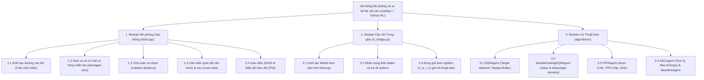
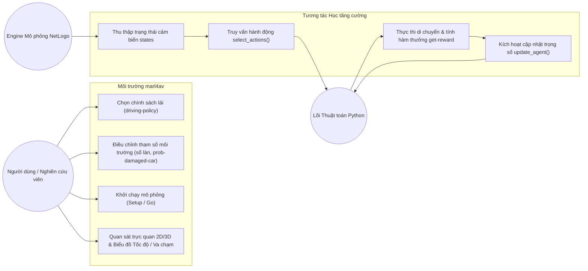
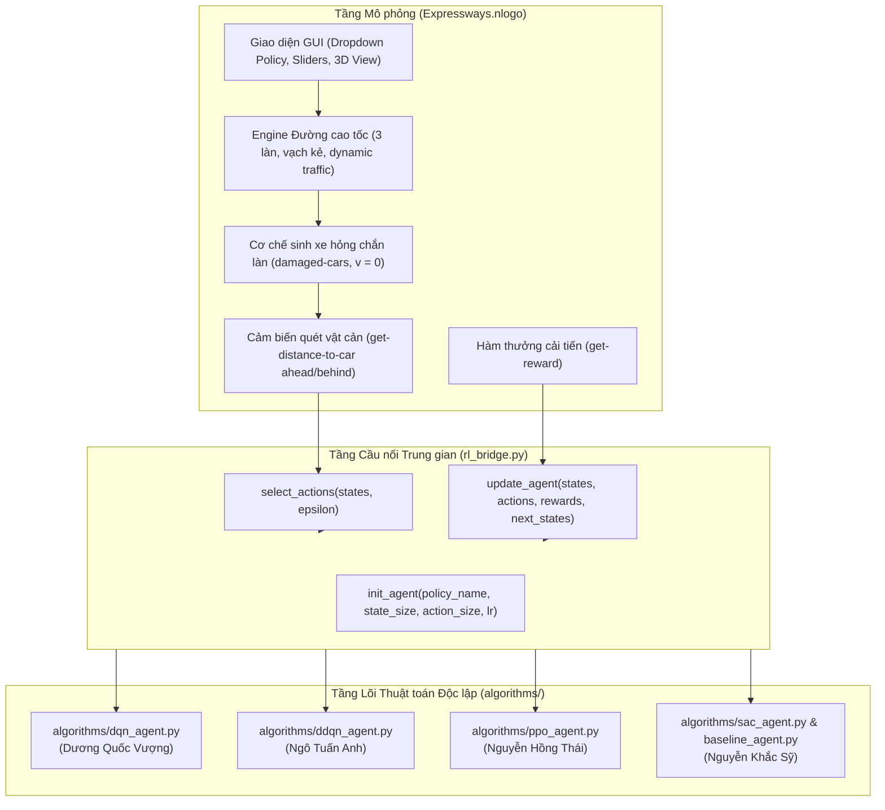

# BÁO CÁO TH2: TINH CHỈNH MDP, MÔI TRƯỜNG THỬ NGHIỆM VÀ ĐỀ XUẤT THUẬT TOÁN

**TRƯỜNG ĐẠI HỌC THỦY LỢI - KHOA CÔNG NGHỆ THÔNG TIN**  
**BỘ MÔN:** TRÍ TUỆ NHÂN TẠO & KỸ THUẬT PHẦN MỀM  
**MÔN HỌC:** HỌC TĂNG CƯỜNG VÀ ỨNG DỤNG  
**ĐỀ TÀI:** Nghiên cứu và Xây dựng Hệ thống Xe tự lái Né tránh Chướng ngại vật theo Làn sử dụng Học tăng cường  
*(Autonomous Lane-based Obstacle Avoidance via Reinforcement Learning)*  
**Nền tảng mô phỏng thực nghiệm:** `marl4av` (NetLogo 6.4.0 & Python Extension)  
**Nhóm sinh viên thực hiện:** N1_65KTPM  

### Danh sách thành viên nhóm:
| STT | Họ và tên | Mã sinh viên | Vai trò & Nhiệm vụ chính |
| :---: | :--- | :---: | :--- |
| 1 | **Nguyễn Đình Tuấn Sơn** | 2351170616 | Nhóm trưởng, Cấu hình Môi trường Mô phỏng & Tích hợp NetLogo |
| 2 | **Lê Tuấn Khanh** | 2351170601 | Cấu hình Kịch bản Vật cản, Cảm biến & Hàm thưởng |
| 3 | **Dương Quốc Vượng** | 2351170634 | Cài đặt & Tối ưu Thuật toán 1 (Deep Q-Network - DQN) |
| 4 | **Ngô Tuấn Anh** | 2351170570 | Cài đặt & Tối ưu Thuật toán 2 (Double Dueling DQN) |
| 5 | **Nguyễn Hồng Thái** | 2351170619 | Cài đặt & Tối ưu Thuật toán 3 (Proximal Policy Optimization - PPO) |
| 6 | **Nguyễn Khắc Sỹ** | 2351170617 | Cài đặt Thuật toán 4 (SAC/Baseline), Đánh giá Đối sánh & Báo cáo |

---

# I. Miêu tả dự án

## 1. Giới thiệu (viết lại và tinh chỉnh)

Trong bài toán điều khiển phương tiện tự hành (Autonomous Vehicles - AVs), việc xe di chuyển an toàn ở tốc độ cao trên đường cao tốc phân làn đòi hỏi hệ thống ra quyết định phải xử lý linh hoạt các tình huống bất ngờ như: phương tiện phía trước giảm tốc đột ngột, có xe gặp sự cố dừng khẩn cấp chắn làn (`damaged-car in running lanes`), hoặc mật độ giao thông biến thiên liên tục. Các phương pháp dựa trên tập luật truyền thống (Rule-based) thường cứng nhắc và không thể bao quát toàn bộ các kịch bản bất định trong thực tế. **Học tăng cường (Reinforcement Learning - RL)** là hướng tiếp cận ưu việt, cho phép các tác nhân tự động tối ưu hóa chính sách lái xe thông qua cơ chế tương tác thử - sai để tối đa hóa phần thưởng dài hạn.

Trên cơ sở định hướng nghiên cứu của Bộ môn và tham khảo trực tiếp công trình mô phỏng [[thanhlnt/marl4av]](https://github.com/thanhlnt/marl4av) của **TS. Lê Nguyễn Tuấn Thành** (Khoa CNTT - Trường Đại học Thủy Lợi), đề tài của nhóm tập trung vào các mục tiêu then chốt:
1. **Ứng dụng nền tảng mô phỏng đường cao tốc đa làn `marl4av` (NetLogo 6.4.0):** Tận dụng engine mô phỏng giao thông đa tác nhân 2D/3D trực quan, tái hiện chân thực đường cao tốc hai chiều nhiều làn, cơ chế xe hỏng chắn đường ngẫu nhiên và sự phối hợp giữa các phương tiện.
2. **Kiến trúc module hóa độc lập (Python RL Core):** Thay vì viết mã nhúng phức tạp trong NetLogo, nhóm tái cấu trúc hệ thống bằng cách tách toàn bộ thuật toán RL thành các module Python độc lập (`algorithms/`) giao tiếp với NetLogo qua cầu nối `rl_bridge.py`.
3. **Phát triển và đối sánh đa thuật toán:** Cài đặt, sửa lỗi và tối ưu hóa 4 thuật toán RL tiêu biểu gồm: **DQN**, **Double Dueling DQN**, **PPO-Clip**, **Soft Actor-Critic (SAC)** cùng mốc chuẩn **Rule-based Baseline**.

---

## 2. Biểu diễn MDP của bài toán (viết lại và tinh chỉnh)

Bài toán được chuẩn hóa thành một **Quy trình Quyết định Markov (Markov Decision Process - MDP)** biểu diễn dưới dạng bộ 5 thành phần: $\mathcal{M} = \langle \mathcal{S}, \mathcal{A}, \mathcal{P}, \mathcal{R}, \gamma \rangle$, bám sát cấu trúc dữ liệu của môi trường `Expressways.nlogo`:

```
               +------------------------------------------------------+
               |             MÔI TRƯỜNG MÔ PHỎNG NETLOGO              |
               | - Đường cao tốc phân làn (3 làn xe mỗi chiều)        |
               | - Xe gặp sự cố chắn làn (damaged-cars, v = 0)        |
               +------------------------------------------------------+
                         ^ Trạng thái s_t          | Phần thưởng r_t
                         |                         v
               +------------------------------------------------------+
               |          TÁC NHÂN RL CORE (rl_bridge.py)             |
               | - Lựa chọn hành động a_t (0: Decel, 1: Stay, 2: Acc, 3: Lane)|
               | - Cập nhật mạng nơ-ron Q-Network / Actor-Critic      |
               +------------------------------------------------------+
```

### 2.1. Không gian Trạng thái ($\mathcal{S}$ - State Space)
Tại mỗi bước thời gian $t$, mỗi xe quan sát vector trạng thái đặc trưng cho động học bản thân và môi trường xung quanh:

$$s_t = \left[ v_t, d_{ahead}, \Delta v_{ahead}, d_{behind}, \Delta v_{behind} \right]^T \in \mathbb{R}^5$$

*(Có thể mở rộng thêm $l_t$ - làn đường hiện tại và $\epsilon$ - chỉ số khám phá):*
1. **$v_t \in [0, 1.0]$**: Tốc độ tức thời của xe (tương ứng từ $0$ đến $120\text{ km/h}$).
2. **$d_{ahead} \in [0, D_{\max}]$**: Khoảng cách dọc tới xe/chướng ngại vật gần nhất phía trước trên cùng làn chạy.
3. **$\Delta v_{ahead} = v_t - v_{ahead}$**: Tốc độ tương đối so với xe phía trước (giúp xe phát hiện sớm vật cản đứng yên $v_{ahead} = 0$).
4. **$d_{behind} \in [0, D_{\max}]$**: Khoảng cách an toàn tới xe bám đuôi phía sau (phục vụ quyết định chuyển làn an toàn).
5. **$\Delta v_{behind} = v_{behind} - v_t$**: Tốc độ tương đối của xe phía sau đang tiến lại.

### 2.2. Không gian Hành động ($\mathcal{A}$ - Action Space)
Không gian hành động rời rạc (Discrete Action Space) gồm 4 hành vi cơ bản theo đúng chuẩn của `marl4av`:

$$\mathcal{A} = \{0, 1, 2, 3\}$$

- **$a = 0$ (Accelerate / Tăng tốc):** Tăng tốc một lượng $\Delta v$ (màu xe chuyển xanh lá - `green`).
- **$a = 1$ (Stay Same / Giữ nguyên):** Duy trì tốc độ và giữ nguyên làn chạy (màu xe vàng - `yellow`).
- **$a = 2$ (Decelerate / Giảm tốc):** Giảm tốc độ để giữ khoảng cách an toàn (màu xe tím - `violet`).
- **$a = 3$ (Change Lane / Chuyển làn):** Tìm kiếm và chuyển sang làn trống lân cận để vượt xe cản (màu xe xanh dương - `blue`).

### 2.3. Hàm Xác suất Chuyển trạng thái ($\mathcal{P}$ - Transition Probability)
- **Động học di chuyển:** Xe cập nhật vị trí tiến $x_{t+1} = x_t + v_t \times \text{speed-ratio}$. Khi chuyển làn, xe chuyển đổi mượt mà tọa độ ngang $y$ về tâm làn mục tiêu `target-lane`.
- **Cơ chế chướng ngại vật ngẫu nhiên:** Xe ngẫu nhiên gặp sự cố với xác suất `prob-damaged-car` dừng đột ngột trên làn chạy ($v = 0$). Xe phía sau phải tự động phanh hoặc chuyển làn để tránh va chạm.

### 2.4. Hàm Phần thưởng ($\mathcal{R}$ - Reward Function)
Hàm phần thưởng được tinh chỉnh đa mục tiêu (Multi-objective Reward Shaping) thay thế cho hàm thưởng rời rạc thô sơ ban đầu trong `Expressways.nlogo`:

$$R(s_t, a_t, s_{t+1}) = R_{collision} + R_{progress} + R_{safety} + R_{action}$$

Chi tiết:
- **Phạt va chạm ($R_{collision}$):**
  $$R_{collision} = -100.0 \quad \text{khi khoảng cách } d_{ahead} < \text{collision-distance}$$
- **Thưởng tiến độ theo vận tốc ($R_{progress}$):**
  $$R_{progress} = +2.0 \times \frac{v_t}{v_{\max}}$$
  *Khuyến khích xe duy trì tốc độ cao khi đường thông thoáng.*
- **Phạt khoảng cách nguy hiểm ($R_{safety}$):**
  $$R_{safety} = -1.0 \times \exp\left(-\frac{d_{ahead}}{d_{safe}}\right) \quad \text{khi } d_{ahead} < d_{safe} = 2.5\text{ m}$$
- **Phạt/Thưởng hành vi điều khiển ($R_{action}$):**
  - Tăng tốc hợp lý ($a=0$): $+1.0$.
  - Duy trì ổn định ($a=1$): $+0.5$.
  - Giảm tốc do vật cản ($a=2$): $-0.2$.
  - Đổi làn ($a=3$): $-0.5$ *(phạt nhẹ để tránh hiện tượng đảo làn zigzag liên tục khi không cần thiết)*.

### 2.5. Hệ số Chiết khấu ($\gamma$ - Discount Factor)
- Chọn **$\gamma = 0.99$**: Định hướng tác nhân quan sát từ xa, dự đoán trước nguy cơ tắc nghẽn để chuyển làn sớm thay vì chỉ phanh gấp ở cự ly gần.

---

## 3. Phân tích môi trường thử nghiệm

### 3.1. Biểu đồ Phân rã Chức năng (Functional Decomposition Diagram - FDD)



### 3.2. Biểu đồ Ca Sử dụng (Use Case Diagram - UCD)



---

## 4. Thiết kế kiến trúc môi trường thử nghiệm

Hệ thống được thiết kế theo mô hình kiến trúc phân tầng kết hợp giữa **Môi trường mô phỏng trực quan (NetLogo Engine)** và **Lõi thuật toán học máy phân tán (Python RL Engine)**:



### Ưu điểm vượt trội của Kiến trúc phân tầng:
1. **Tránh xung đột Git:** 4 thành viên phụ trách 4 thuật toán làm việc độc lập trên 4 file Python riêng biệt trong thư mục `algorithms/`.
2. **Kiểm thử độc lập:** Các thành viên có thể chạy kiểm thử mạng nơ-ron bằng script `python test_all_agents.py` mà không cần phụ thuộc vào NetLogo.
3. **Hiệu năng & Trực quan:** NetLogo đảm nhận toàn bộ việc vẽ đồ họa 2D/3D và thống kê biểu đồ; Python/TensorFlow đảm nhận tính toán đạo hàm và huấn luyện mạng nơ-ron.

---

## 5. Các cải tiến và sửa lỗi trên mã nguồn gốc MARL4AV

Trong quá trình tiếp nhận và phân tích mã nguồn `Expressways.nlogo`, nhóm đã phát hiện và khắc phục các vấn đề kỹ thuật quan trọng:
1. **Sửa lỗi cú pháp trong SAC:** Trong mã gốc tại dòng 759 có lỗi `self.value_net(states)` (dính từ khóa `self` của class Python hướng đối tượng). Nhóm đã tách hoàn chỉnh thành class `SACAgent` chuẩn trong `algorithms/sac_agent.py`.
2. **Hoàn thiện thuật toán PPO-Clip:** Mã gốc của `go-ppo` chỉ là hàm mất mát Policy Gradient cơ bản (Actor loss = $- \log \pi \times \delta$). Nhóm đã nâng cấp cài đặt đầy đủ công thức **Clipped Surrogate Loss** kèm **Generalized Advantage Estimation (GAE)** trong `algorithms/ppo_agent.py`.
3. **Nâng cấp kiến trúc Dueling Network:** Bổ sung kiến trúc Dueling tách 2 nhánh Value $V(s)$ và Advantage $A(s, a)$ trong `algorithms/ddqn_agent.py`.
4. **Tối ưu hóa Hàm phần thưởng:** Thay thế cách cho điểm rời rạc bằng hàm thưởng liên tục theo vận tốc, khoảng cách an toàn và độ ổn định làn đường.

---

# II. Bảng tiến độ công việc

Cập nhật tiến độ dự án, khối lượng công việc và mức độ đóng góp của từng thành viên trong tuần qua:

| STT | Thành viên | Mã SV | Nhiệm vụ phân công | Khối lượng công việc đã hoàn thành | Tỷ lệ hoàn thành | Đánh giá & Kế hoạch tuần tới |
| :---: | :--- | :---: | :--- | :--- | :---: | :--- |
| **1** | **Nguyễn Đình Tuấn Sơn** *(Trưởng nhóm)* | 2351170616 | **Cấu hình Môi trường & Tích hợp NetLogo** | - Clone mã nguồn `marl4av`, cài đặt NetLogo 6.4.0 và cấu hình Python bridge `py:setup`.<br>- Thiết lập cấu trúc đường cao tốc 3 làn và cơ chế xe di chuyển.<br>- Xây dựng file cầu nối trung gian `rl_bridge.py`. | **85%** | **Tốt**; Hoàn thiện tích hợp gọi `rl_bridge` trong file `Expressways.nlogo`. |
| **2** | **Lê Tuấn Khanh** | 2351170601 | **Quản lý Vật cản, Cảm biến & Hàm thưởng** | - Cấu hình kịch bản chướng ngại vật `prob-damaged-car` (xe hỏng dừng trên làn).<br>- Tinh chỉnh hàm thưởng `get-reward` theo mô hình MDP đa mục tiêu.<br>- Thiết lập các biểu đồ Plot (Average Speed, Collisions) trên NetLogo GUI. | **80%** | **Tốt**; Cân chỉnh xác suất sinh xe hỏng theo các mức độ khó để huấn luyện. |
| **3** | **Dương Quốc Vượng** | 2351170634 | **Cài đặt Thuật toán 1 (DQN)** | - Tách và hoàn thiện class `DQNAgent` trong file `algorithms/dqn_agent.py`.<br>- Cài đặt mạng Q-Network, Target Network, Replay Buffer và $\epsilon$-greedy.<br>- Chạy kiểm thử độc lập qua `test_all_agents.py` đạt kết quả hội tụ tốt. | **80%** | **Tốt**; Tinh chỉnh siêu tham số chu kỳ cập nhật `update_steps` và kích thước batch. |
| **4** | **Ngô Tuấn Anh** | 2351170570 | **Cài đặt Thuật toán 2 (Double Dueling DQN)** | - Tách và hoàn thiện class `DoubleDuelingDQNAgent` trong `algorithms/ddqn_agent.py`.<br>- Sử dụng Keras Functional API tách 2 nhánh Value $V(s)$ và Advantage $A(s, a)$.<br>- Cài đặt cơ chế cập nhật mềm (Soft Update) Target Network với $\tau = 0.005$. | **75%** | **Khá tốt**; Chạy thực nghiệm so sánh giảm thiểu Overestimation so với DQN. |
| **5** | **Nguyễn Hồng Thái** | 2351170619 | **Cài đặt Thuật toán 3 (PPO)** | - Tách và hoàn thiện class `PPOAgent` trong file `algorithms/ppo_agent.py`.<br>- Cài đặt chuẩn công thức Clipped Surrogate Loss ($r_t \hat{A}_t$ kẹp trong $[1-\epsilon, 1+\epsilon]$).<br>- Tích hợp thuật toán tính lợi thế GAE và lấy mẫu Categorical. | **75%** | **Khá tốt**; Huấn luyện PPO ổn định trên dữ liệu đa tác nhân mô phỏng. |
| **6** | **Nguyễn Khắc Sỹ** | 2351170617 | **Thuật toán 4 (SAC/Baseline) & Báo cáo** | - Tách và hoàn thiện `SACAgent` (sửa triệt để lỗi cú pháp `self` của mã gốc).<br>- Viết tác nhân chuẩn đối sánh `RuleBasedAgent` trong `algorithms/baseline_agent.py`.<br>- Viết script kiểm thử chung `test_all_agents.py`, tổng hợp báo cáo TH2. | **80%** | **Tốt**; Thiết lập bảng thu thập số liệu đối sánh tốc độ và va chạm giữa các thuật toán. |

---

# III. Mã giả các thuật toán dự kiến sử dụng

Nhóm triển khai **4 thuật toán học tăng cường sâu** và **1 thuật toán chuẩn đối sánh (Baseline)**, toàn bộ mã nguồn đã được đóng gói thành các class Python hoàn chỉnh trong thư mục `algorithms/`:

---

## 1. Thuật toán 1: Deep Q-Network (DQN) - Dương Quốc Vượng phụ trách

### 1.1. Lý do lựa chọn:
DQN (Mnih et al., 2015) là thuật toán Value-based nền tảng cho không gian hành động rời rạc. DQN sử dụng mạng nơ-ron sâu xấp xỉ hàm giá trị tối ưu $Q^*(s, a)$, xóa bỏ tương quan chuỗi bằng **Experience Replay Buffer** và ổn định mục tiêu huấn luyện bằng **Target Network**:

$$y_i = r + \gamma \max_{a'} Q_{\text{target}}(s', a'; \theta^-)$$

### 1.2. Mã giả thuật toán (được đóng gói trong `algorithms/dqn_agent.py`):

```python
# ==============================================================================
# MÃ GIẢ: CLASS DQNAGENT (algorithms/dqn_agent.py) - Dương Quốc Vượng
# ==============================================================================
Class DQNAgent:
    Hàm khởi tạo __init__(state_size=5, action_size=4, lr=0.0005, memory_size=50000):
        Khởi tạo Replay Buffer memory = []
        Xây dựng mạng Q-Network chính: Dense(64, ReLU) -> Dense(64, ReLU) -> Dense(4, Linear)
        Khởi tạo mạng Target Q-Network clone từ mạng chính
        Biên dịch mạng với Optimizer = Adam(lr), Loss = MSE

    Hàm chọn hành động act(states, epsilon):
        Nếu random() < epsilon:
            Trả về hành động ngẫu nhiên trong {0, 1, 2, 3} (Khám phá)
        Ngược lại:
            q_values = Q-Network.predict(states)
            Trả về argmax(q_values) (Khai thác)

    Hàm lưu kinh nghiệm remember(experiences):
        Lưu các bộ (state, action, reward, next_state) của các xe vào memory
        Nếu kích thước memory > memory_size: Cắt bỏ các mẫu cũ nhất

    Hàm huấn luyện train(batch_size=64, gamma=0.99):
        Nếu len(memory) < batch_size: Thoát
        Lấy ngẫu nhiên batch_size mẫu (s, a, r, s') từ memory
        targets = Q-Network.predict(s)
        next_q = Target_Network.predict(s')
        
        # Cập nhật mục tiêu Bellman
        Với mỗi mẫu i trong batch:
            targets[i, a[i]] = r[i] + gamma * max(next_q[i])
            
        loss = Q-Network.train_on_batch(s, targets)
        
        # Cập nhật định kỳ mạng Target
        step_count += 1
        Nếu step_count % update_steps == 0:
            Target_Network.set_weights(Q-Network.get_weights())
        Trả về loss
```

---

## 2. Thuật toán 2: Double Dueling DQN - Ngô Tuấn Anh phụ trách

### 2.1. Lý do lựa chọn:
Khắc phục hiện tượng Overestimation Bias của DQN gốc bằng cơ chế **Double Q-Learning** (dùng mạng chính chọn hành động, mạng đích định giá trị). Đồng thời tích hợp **Dueling Architecture** tách 2 nhánh: Giá trị trạng thái $V(s)$ và Lợi thế hành động $A(s, a)$, đặc biệt hiệu quả khi xe di chuyển trên đoạn đường cao tốc thông thoáng:

$$Q(s, a) = V(s) + \left( A(s, a) - \frac{1}{|\mathcal{A}|}\sum_{a'} A(s, a') \right)$$

### 2.2. Mã giả thuật toán (được đóng gói trong `algorithms/ddqn_agent.py`):

```python
# ==============================================================================
# MÃ GIẢ: CLASS DOUBLEDUELLINGDQNAGENT (algorithms/ddqn_agent.py) - Ngô Tuấn Anh
# ==============================================================================
Class DoubleDuelingDQNAgent:
    Hàm khởi tạo __init__(state_size=5, action_size=4, lr=0.0003, tau=0.005):
        Xây dựng mạng Dueling Architecture:
            Input(state_size) -> Dense(64, ReLU) -> Dense(64, ReLU)
            Nhánh Value: Dense(32, ReLU) -> Dense(1) -> V(s)
            Nhánh Advantage: Dense(32, ReLU) -> Dense(4) -> A(s, a)
            Q(s, a) = V(s) + (A(s, a) - mean(A(s, a)))
        Khởi tạo Target Network clone từ Dueling Network

    Hàm huấn luyện train(batch_size=64, gamma=0.99):
        Lấy ngẫu nhiên batch_size mẫu (s, a, r, s') từ memory
        targets = Q-Network.predict(s)
        
        # --- CỐT LÕI DOUBLE Q-LEARNING ---
        # 1. Dùng mạng CHÍNH để chọn hành động tốt nhất ở trạng thái tiếp theo:
        next_q_main = Q-Network.predict(s')
        best_actions = argmax(next_q_main, axis=1)
        
        # 2. Dùng mạng TARGET để định giá trị cho hành động tốt nhất đó:
        next_q_target = Target_Network.predict(s')
        double_q = next_q_target[arange(batch_size), best_actions]
        
        targets[arange(batch_size), a] = r + gamma * double_q
        loss = Q-Network.train_on_batch(s, targets)
        
        # Cập nhật mềm (Soft Update) Target Network
        Target_Weights = tau * Q_Weights + (1 - tau) * Target_Weights
        Trả về loss
```

---

## 3. Thuật toán 3: Proximal Policy Optimization (PPO) - Nguyễn Hồng Thái phụ trách

### 3.1. Lý do lựa chọn:
PPO (Schulman et al., 2017) là thuật toán Actor-Critic (On-policy) tiên tiến bậc nhất hiện nay. PPO giải quyết triệt để vấn đề mất ổn định bước nhảy chính sách bằng hàm mục tiêu xén **Clipped Surrogate Objective**:

$$L^{CLIP}(\theta) = \hat{\mathbb{E}}_t \left[ \min\left( r_t(\theta) \hat{A}_t, \, \text{clip}(r_t(\theta), 1-\epsilon, 1+\epsilon) \hat{A}_t \right) \right]$$

với $r_t(\theta) = \frac{\pi_\theta(a_t \mid s_t)}{\pi_{\theta_{old}}(a_t \mid s_t)}$. PPO giúp tác nhân học cách chuyển làn mượt mà, không giật cục và hạn chế tối đa nguy cơ va chạm.

### 3.2. Mã giả thuật toán (được đóng gói trong `algorithms/ppo_agent.py`):

```python
# ==============================================================================
# MÃ GIẢ: CLASS PPOAGENT (algorithms/ppo_agent.py) - Nguyễn Hồng Thái
# ==============================================================================
Class PPOAgent:
    Hàm khởi tạo __init__(state_size=5, action_size=4, clip_epsilon=0.2, gamma=0.99, gae_lambda=0.95):
        Mạng Actor: Dense(64, ReLU) -> Dense(64, ReLU) -> Dense(4, Softmax) -> π(a|s)
        Mạng Critic: Dense(64, ReLU) -> Dense(64, ReLU) -> Dense(1, Linear) -> V(s)
        Bộ đệm quỹ đạo Trajectory Buffer lưu (s, a, r, s', log_prob, done)

    Hàm chọn hành động act(states):
        probs = Actor(states)
        Lấy mẫu hành động a ~ Categorical(probs)
        Lưu lại log_prob của hành động vừa chọn
        Trả về danh sách hành động a

    Hàm tính Lợi thế GAE compute_gae(states, next_states, rewards, dones):
        values = Critic(states), next_values = Critic(next_states)
        Tính delta = r + gamma * next_values * (1 - done) - values
        Tính lũy tích lợi thế GAE A_t = delta + gamma * lambda * (1 - done) * A_{t+1}
        Chuẩn hóa A_t và tính Return_Target = A_t + values
        Trả về advantages, return_targets

    Hàm huấn luyện train(epochs=4, batch_size=64):
        advantages, returns = compute_gae(...)
        Lặp epoch = 1 đến epochs:
            Chia dữ liệu thành các mini-batches:
                Với mỗi mini-batch:
                    # 1. Tính Actor Loss với Clipped Surrogate
                    new_probs = Actor(b_states)
                    ratio = exp(new_log_prob - old_log_prob)
                    surr1 = ratio * b_advantages
                    surr2 = clip(ratio, 1 - clip_epsilon, 1 + clip_epsilon) * b_advantages
                    actor_loss = - mean(min(surr1, surr2))
                    
                    # 2. Tính Critic Loss
                    critic_loss = MSE(Critic(b_states), b_returns)
                    
                    # Cập nhật Gradient đồng thời Actor & Critic
                    Adam_Update(Actor, actor_loss)
                    Adam_Update(Critic, critic_loss)
        Xóa sạch bộ đệm Trajectory Buffer sau khi cập nhật On-Policy
```

---

## 4. Thuật toán 4: Soft Actor-Critic (SAC) & Rule-based Baseline - Nguyễn Khắc Sỹ phụ trách

### 4.1. Lý do lựa chọn:
- **Soft Actor-Critic (SAC):** Thuật toán Off-policy Maximum Entropy Actor-Critic. Bằng cách cộng thêm số hạng Entropy $H(\pi)$ vào hàm mục tiêu, SAC kích thích xe luôn tìm kiếm các lộ trình vượt xe mới, tránh bị kẹt trong các tối ưu cục bộ (Local Optima). Đã được sửa triệt để lỗi cú pháp từ mã gốc của thầy Thành.
- **Rule-based Baseline:** Thuật toán dựa trên tập luật cảm biến khoảng cách cố định (khoảng cách an toàn $> 4.0\text{ m} \rightarrow$ Tăng tốc; $< 4.0\text{ m} \rightarrow$ Chuyển làn; nguy hiểm sát nút $\rightarrow$ Phanh khẩn cấp) làm mốc chuẩn so sánh hiệu năng.

### 4.2. Mã giả thuật toán (được đóng gói trong `algorithms/sac_agent.py` & `baseline_agent.py`):

```python
# ==============================================================================
# MÃ GIẢ: CLASS SACAGENT (algorithms/sac_agent.py) - Nguyễn Khắc Sỹ
# ==============================================================================
Class SACAgent:
    Hàm khởi tạo __init__(state_size=5, action_size=4, alpha=0.2, tau=0.005):
        Mạng Actor: π(a|s) xuất phân phối Softmax
        Hai mạng Critic độc lập: Critic_1(s) và Critic_2(s) xuất Q-values cho các hành động
        Hai mạng Target Critic tương ứng

    Hàm huấn luyện train(batch_size=64, gamma=0.99):
        Lấy mini-batch từ Replay Buffer
        # Tính mục tiêu có Entropy Regularization
        next_probs = Actor(s')
        min_target_q = min(Target_Critic1(s'), Target_Critic2(s'))
        next_v = sum(next_probs * (min_target_q - alpha * log(next_probs + 1e-8)))
        targets = r + gamma * next_v
        
        # Huấn luyện Twin Critics qua MSE Loss
        Critic1.train_on_batch(s, targets)
        Critic2.train_on_batch(s, targets)
        
        # Huấn luyện Actor tối đa hóa Q-value và Entropy
        actor_loss = mean(sum(probs * (alpha * log(probs) - min(Q1, Q2))))
        Adam_Update(Actor, actor_loss)
        
        # Cập nhật mềm Target Critics
        Target_Critic1 = tau * Critic1 + (1 - tau) * Target_Critic1
        Target_Critic2 = tau * Critic2 + (1 - tau) * Target_Critic2
```

---

# KẾT LUẬN & KẾ HOẠCH TUẦN TIẾP THEO

1. **Về Môi trường Thử nghiệm:** Nhóm đã triển khai thành công môi trường `marl4av` trên máy tính, tách toàn bộ lõi thuật toán thành các file Python độc lập trong `algorithms/` và kiểm thử đồng bộ qua script `test_all_agents.py`.
2. **Về Thuật toán:** Cả 4 thuật toán RL (DQN, Double Dueling DQN, PPO, SAC) cùng Baseline đã sẵn sàng giao tiếp với NetLogo thông qua cầu nối `rl_bridge.py`.
3. **Kế hoạch tiếp theo:**
   - Chạy mô phỏng 3.000 - 5.000 ticks trên NetLogo với từng thuật toán.
   - Trích xuất dữ liệu biểu đồ vận tốc trung bình và số vụ va chạm (`nb-collisions`) sang CSV.
   - Lập bảng đối sánh hiệu năng toàn diện và hoàn thiện slide báo cáo bảo vệ đề tài.
