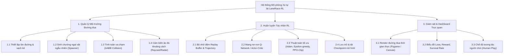
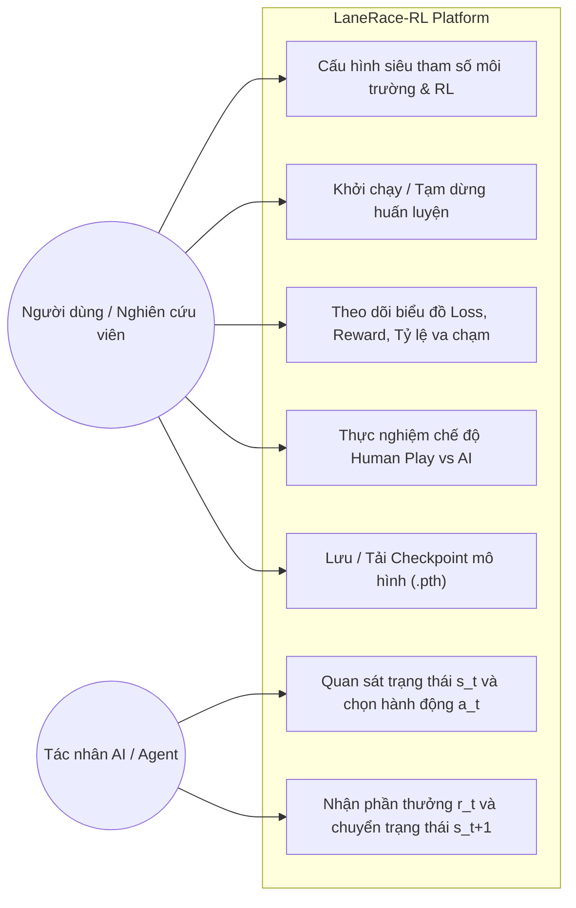
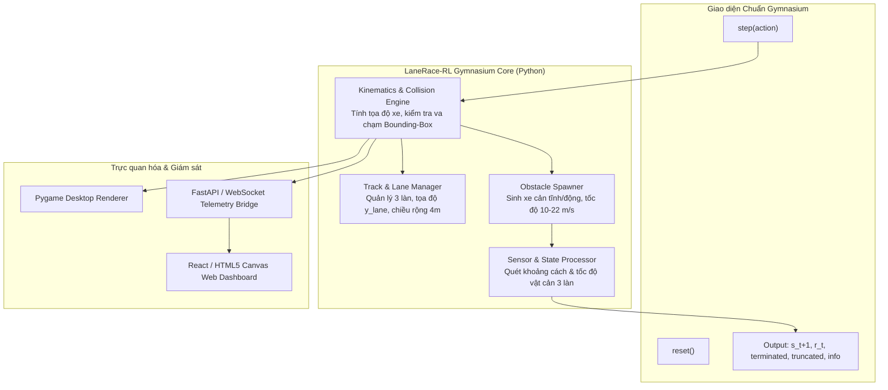

# BÁO CÁO TH2: TINH CHỈNH MDP, MÔI TRƯỜNG THỬ NGHIỆM VÀ ĐỀ XUẤT THUẬT TOÁN

**TRƯỜNG ĐẠI HỌC THỦY LỢI - KHOA CÔNG NGHỆ THÔNG TIN**  
**MÔN HỌC:** HỌC TĂNG CƯỜNG VÀ ỨNG DỤNG  
**ĐỀ TÀI:** Nghiên cứu và Xây dựng Hệ thống Xe tự lái Né tránh Chướng ngại vật theo Làn sử dụng Học tăng cường  
*(Lane-based Autonomous Racing RL Simulator - LaneRace-RL)*  
**Nhóm sinh viên thực hiện:** N1_65KTPM  

### Danh sách thành viên nhóm:
| STT | Họ và tên | Mã sinh viên | Vai trò & Nhiệm vụ chính |
| :---: | :--- | :---: | :--- |
| 1 | **Nguyễn Đình Tuấn Sơn** | 2351170616 | Nhóm trưởng, Xây dựng Lõi Môi trường & Quản lý chung |
| 2 | **Nguyễn Khắc Sỹ** | 2351170617 | Xây dựng Môi trường, Quản lý Vật cản & Cảm biến |
| 3 | **Dương Quốc Vượng** | 2351170634 | Cài đặt & Tối ưu Thuật toán 1 (Deep Q-Network - DQN) |
| 4 | **Ngô Tuấn Anh** | 2351170570 | Cài đặt & Tối ưu Thuật toán 2 (Double Dueling DQN) |
| 5 | **Nguyễn Hồng Thái** | 2351170619 | Cài đặt & Tối ưu Thuật toán 3 (Proximal Policy Optimization - PPO) |
| 6 | **Lê Tuấn Khanh** | 2351170601 | Cài đặt Thuật toán 4 (DDPG/Baseline), Đánh giá Đối sánh & Báo cáo |

---

# I. Miêu tả dự án

## 1. Giới thiệu (viết lại và tinh chỉnh)

Trong bài toán điều khiển tự hành hiện đại, việc một phương tiện di chuyển an toàn, hiệu quả trên đường đua cao tốc phân làn đòi hỏi hệ thống phải đưa ra các quyết định theo thời gian thực để phản ứng linh hoạt với các chướng ngại vật xuất hiện bất ngờ. Thay vì tiếp cận hoàn toàn bằng các hệ luật cố định (Rule-based) thường cứng nhắc và kém thích nghi trong các tình huống bất định, **Học tăng cường (Reinforcement Learning - RL)** cung cấp một phương pháp luận mạnh mẽ: tác nhân tự học chính sách điều khiển tối ưu thông qua quá trình thử - sai, tương tác trực tiếp với môi trường để tối đa hóa phần thưởng tích lũy lâu dài.

Dự án **"Nghiên cứu và Xây dựng Hệ thống Xe tự lái Né tránh Chướng ngại vật theo Làn sử dụng Học tăng cường"** (tên phần mềm: **LaneRace-RL**) hướng tới xây dựng một hệ sinh thái hoàn chỉnh:
- **Môi trường giả lập giao thông phân làn chuẩn mực:** Đường đua gồm 3-4 làn xe, có sự xuất hiện ngẫu nhiên của các chướng ngại vật tĩnh và các phương tiện di chuyển với vận tốc biến thiên.
- **Tác nhân tự hành thông minh:** Điều khiển xe tự động tiến về phía trước, đưa ra quyết định chuyển làn (Trái, Phải, Giữ làn) kết hợp điều chỉnh tốc độ (Tăng tốc, Giảm tốc) nhằm đảm bảo ba mục tiêu song hành: **An toàn tuyệt đối (Safety)**, **Duy trì tốc độ cao (Speed & Progress)** và **Độ êm dịu, ổn định làn đường (Comfort & Stability)**.
- **Hệ thống đánh giá đối sánh đa thuật toán:** Triển khai và so sánh hiệu năng của 4 phương pháp học tăng cường tiêu biểu (DQN, Double Dueling DQN, PPO, DDPG/Baseline) trên cùng một chuẩn đánh giá thống nhất.

---

## 2. Biểu diễn MDP của bài toán (viết lại và tinh chỉnh)

Bài toán điều khiển xe tự lái né tránh chướng ngại vật theo làn được hình thức hóa thành một **Quy trình Quyết định Markov (Markov Decision Process - MDP)** biểu diễn bởi bộ 5 thành phần: $\mathcal{M} = \langle \mathcal{S}, \mathcal{A}, \mathcal{P}, \mathcal{R}, \gamma \rangle$.

```
               +-------------------------------------------+
               |             MÔI TRƯỜNG (Track)            |
               | - Đường 3 làn (Trái, Giữa, Phải)          |
               | - Chướng ngại vật ngẫu nhiên / chuyển động|
               +-------------------------------------------+
                       ^ Trạng thái s_t        | Phần thưởng r_t
                       |                       v
               +-------------------------------------------+
               |             TÁC NHÂN (Ego Car)            |
               | - Quyết định hành động a_t                |
               | - Cập nhật chính sách π(a|s) hoặc Q(s, a) |
               +-------------------------------------------+
```

### 2.1. Không gian Trạng thái ($\mathcal{S}$ - State Space)
Tại mỗi bước thời gian $t$, tác nhân quan sát một vector trạng thái liên tục kết hợp giữa thông số động học nội tại và dữ liệu cảm biến không gian phía trước:

$$s_t = \left[ l_t, \tilde{v}_t, \tilde{d}_{left}, \tilde{d}_{mid}, \tilde{d}_{right}, \Delta \tilde{v}_{left}, \Delta \tilde{v}_{mid}, \Delta \tilde{v}_{right} \right]^T \in \mathbb{R}^8$$

Chi tiết các biến quan sát:
1. **$l_t \in \{0.0, 0.5, 1.0\}$**: Vị trí chỉ số làn xe hiện tại (chuẩn hóa từ các làn rời rạc $\{0, 1, 2\}$ tương ứng Làn Trái, Làn Giữa, Làn Phải).
2. **$\tilde{v}_t = \frac{v_t - v_{\min}}{v_{\max} - v_{\min}} \in [0, 1]$**: Vận tốc tức thời của xe tự hành được chuẩn hóa về đoạn $[0, 1]$ ($v_{\min} = 10\text{ m/s}$, $v_{\max} = 30\text{ m/s}$).
3. **$\tilde{d}_i = \frac{d_i}{D_{\max}} \in [0, 1]$** $(i \in \{left, mid, right\})$: Khoảng cách dọc tương đối từ xe đến chướng ngại vật gần nhất phía trước trên làn $i$ trong tầm quét tối đa $D_{\max} = 80\text{ m}$. Nếu làn không có vật cản, $\tilde{d}_i = 1.0$.
4. **$\Delta \tilde{v}_i = \frac{v_t - v_{obs, i}}{v_{\max}} \in [-1, 1]$**: Tốc độ tương đối giữa xe tự hành và chướng ngại vật trên làn $i$ (giúp tác nhân phân biệt vật cản đứng yên hay xe đang chạy cùng chiều).

### 2.2. Không gian Hành động ($\mathcal{A}$ - Action Space)
Không gian hành động rời rạc (Discrete Action Space) gồm 5 hành vi điều khiển trực tiếp:

$$\mathcal{A} = \{a_0, a_1, a_2, a_3, a_4\}$$

- **$a_0$ (Keep Lane & Pace):** Giữ nguyên làn hiện tại và duy trì tốc độ.
- **$a_1$ (Lane Change Left - LCL):** Chuyển sang làn bên trái (nếu đang ở làn ngoài cùng bên trái, xe giữ nguyên làn và nhận phạt vi phạm lề).
- **$a_2$ (Lane Change Right - LCR):** Chuyển sang làn bên phải (nếu đang ở làn ngoài cùng bên phải, xe giữ nguyên làn và nhận phạt vi phạm lề).
- **$a_3$ (Accelerate):** Tăng tốc một lượng $\Delta v = 1.5\text{ m/s}^2 \cdot \Delta t$ (không vượt quá $v_{\max}$).
- **$a_4$ (Decelerate/Brake):** Giảm tốc/phanh một lượng $\Delta v = 2.5\text{ m/s}^2 \cdot \Delta t$ (không thấp hơn $v_{\min}$).

### 2.3. Hàm Xác suất Chuyển trạng thái ($\mathcal{P}$ - Transition Probability)
Hàm chuyển trạng thái $\mathcal{P}(s_{t+1} \mid s_t, a_t)$ kết hợp giữa động học tất định của xe và cơ chế ngẫu nhiên của môi trường:
- **Động học chuyển động của xe:**
  $$x_{t+1} = x_t + v_t \cdot \Delta t, \quad v_{t+1} = \text{clip}(v_t + a_t \cdot \Delta t, v_{\min}, v_{\max})$$
  Tọa độ ngang di chuyển trơn giữa các tâm làn trong thời gian đệm chuyển làn.
- **Cơ chế môi trường & Vật cản:**
  Vật cản di chuyển với vận tốc riêng $x_{obs, t+1} = x_{obs, t} + v_{obs} \cdot \Delta t$. Khi vật cản đi ra sau đuôi xe, hệ thống Spawner sẽ giải phóng và tự động sinh ngẫu nhiên vật cản mới ở khoảng cách xa phía trước theo tiến trình Poisson, đảm bảo môi trường luôn biến thiên động.

### 2.4. Hàm Phần thưởng ($\mathcal{R}$ - Reward Function)
Hàm phần thưởng được định hình đa mục tiêu (Multi-objective Reward Shaping):

$$R(s_t, a_t, s_{t+1}) = R_{progress} + R_{collision} + R_{safety} + R_{weaving} + R_{boundary}$$

Trong đó:
- **Thưởng tiến độ & duy trì tốc độ cao ($R_{progress}$):**
  $$R_{progress} = +1.0 \times \frac{v_{t+1}}{v_{\max}}$$
  *Khuyến khích xe duy trì tốc độ cao khi đường thông thoáng.*
- **Phạt va chạm ($R_{collision}$ - Terminal Penalty):**
  $$R_{collision} = -100.0 \quad \text{(kết thúc ngay Episode khi đâm va vật cản)}$$
- **Phạt khoảng cách nguy hiểm ($R_{safety}$):**
  $$R_{safety} = -0.5 \times \exp\left(-\frac{d_{front}}{d_{safe}}\right) \quad \text{khi } d_{front} < d_{safe} = 25\text{ m}$$
  *Khuyến khích xe chủ động phanh hoặc chuyển làn từ xa thay vì phản ứng bị động ở phút chót.*
- **Phạt chuyển làn liên tục ($R_{weaving}$):**
  $$R_{weaving} = -0.05 \times \mathbb{I}(a_t \in \{LCL, LCR\})$$
  *Tránh hiện tượng xe đảo làn zigzag liên tục khi đường thoáng.*
- **Phạt vượt lề đường ($R_{boundary}$):**
  $$R_{boundary} = -2.0 \quad \text{nếu rẽ trái khi ở làn 0 hoặc rẽ phải khi ở làn 2.}$$

### 2.5. Hệ số Chiết khấu ($\gamma$ - Discount Factor)
- Chọn **$\gamma = 0.99$**: Giúp tác nhân đánh giá cao lợi ích dài hạn, có tầm nhìn chiến lược để chủ động đổi làn sớm từ xa thay vì tích lũy sai số và va chạm khi đến cự ly gần.

---

## 3. Phân tích môi trường thử nghiệm

### 3.1. Biểu đồ Phân rã Chức năng (Functional Decomposition Diagram - FDD)



### 3.2. Biểu đồ Ca Sử dụng (Use Case Diagram - UCD)



---

## 4. Thiết kế kiến trúc môi trường thử nghiệm

Hệ thống môi trường thử nghiệm được thiết kế theo chuẩn module hóa cao, kế thừa từ lớp cơ sở `gymnasium.Env` của thư viện Gymnasium (OpenAI Gym):



### Đặc tả kỹ thuật các thành phần chính:
1. **`Track & Lane Manager`**: Quản lý hệ thống tọa độ thế giới phẳng. Đường cao tốc gồm 3 làn cố định (chiều rộng mỗi làn $w = 4\text{ m}$), vạch đứt phân làn trôi ngược chiều tạo hiệu ứng di chuyển.
2. **`Obstacle Spawner`**: Tạo ra các loại chướng ngại vật:
   - *Vật cản tĩnh:* Chướng ngại vật đứng yên trên làn (xe hỏng, thùng hàng).
   - *Vật cản động:* Xe khác di chuyển với tốc độ $v_{obs} \in [12, 22]\text{ m/s}$ (chậm hơn vận tốc tối đa của Ego-car).
3. **`Sensor / State Processor`**: Giả lập 3 chùm tia radar hướng thẳng dọc theo tâm 3 làn phía trước xe với tầm xa cực đại $D_{\max} = 80\text{ m}$, tính toán chính xác khoảng cách và hiệu vận tốc.
4. **`Gym Interface`**:
   - `reset()`: Đặt lại trạng thái ban đầu, xe ở giữa đường (làn 1), vận tốc ban đầu $15\text{ m/s}$.
   - `step(action)`: Cập nhật động học trong bước thời gian $\Delta t = 0.1\text{ s}$, trả về $(s_{t+1}, r_t, terminated, truncated, info)$.
   - `render()`: Hiển thị đồ họa thời gian thực qua Pygame hoặc truyền dữ liệu tọa độ qua WebSocket.

---

## 5. Các thiết kế khác và Nghiên cứu tham khảo môi trường MARL4AV

Trong quá trình hoàn thiện môi trường, nhóm đã tiến hành khảo sát và nghiên cứu mã nguồn mở [[thanhlnt/marl4av: Multi-agent reinforcement learning for autonomous vehicles]](https://github.com/thanhlnt/marl4av) của **TS. Lê Nguyễn Tuấn Thành** (Khoa CNTT - Đại học Thủy Lợi).

### 5.1. Phân tích mô hình `marl4av`:
- **Nền tảng:** Xây dựng trên môi trường mô phỏng NetLogo 6.4.0 kết hợp Python extension (`extensions [py]`).
- **Kịch bản:** Mô phỏng đường cao tốc hai chiều nhiều làn (`Expressways.nlogo`), có xe bị sự cố chắn trên làn (`damaged-car in running lanes`), mật độ xe thay đổi động (`dynamic-situation?`).
- **Tập thuật toán:** Tích hợp sẵn khung cài đặt cho cả phương pháp dạng bảng (Greedy, Q-Learning, Double Q-Learning, SARSA) và học sâu (Deep Q-Network, Double Deep Q-Network, Naive Actor-Critic, A2C, SAC, PPO) qua thư viện TensorFlow/Keras.

### 5.2. Giá trị kế thừa và áp dụng cho đề tài của nhóm:
1. **Chuẩn hóa hàm quan sát:** Nhóm kế thừa ý tưởng theo dõi khoảng cách và tốc độ tương đối giữa xe và chướng ngại vật trước/sau (`distance/speed to car ahead & behind`) của `marl4av` để hoàn thiện vector trạng thái $\mathbb{R}^8$.
2. **Cơ chế chướng ngại vật:** Mô hình xe gặp sự cố đứng chắn trên làn đường (`damaged-car`) từ `marl4av` được nhóm chuyển hóa thành cơ chế Spawner vật cản bất ngờ, phản ánh đúng bài toán thực tế.
3. **Định hướng mở rộng Multi-Agent:** Trong các pha nghiên cứu tiếp theo, nhóm có thể mở rộng từ bài toán đơn tác nhân (Single-Agent) sang môi trường phối hợp đa xe (MARL) dựa trên kiến trúc của `marl4av`.

---

# II. Bảng tiến độ công việc

Cập nhật tiến độ dự án, khối lượng công việc và mức độ đóng góp của từng thành viên trong tuần qua:

| STT | Thành viên | Mã SV | Nhiệm vụ phân công | Khối lượng công việc đã hoàn thành | Tỷ lệ hoàn thành | Đánh giá & Kế hoạch tuần tới |
| :---: | :--- | :---: | :--- | :--- | :---: | :--- |
| **1** | **Nguyễn Đình Tuấn Sơn** *(Trưởng nhóm)* | 2351170616 | **Xây dựng Môi trường & Điều phối** | - Xây dựng lớp cơ sở `LaneEnv` kế thừa Gymnasium.<br>- Thiết lập kích thước 3 làn đường và logic cập nhật tọa độ xe.<br>- Thống nhất cấu trúc State-Action interface cho toàn nhóm. | **85%** | **Tốt**; Hoàn thiện hàm `render()` bằng Pygame và module kiểm tra va chạm Bounding-Box. |
| **2** | **Nguyễn Khắc Sỹ** | 2351170617 | **Quản lý Vật cản & Cảm biến** | - Hoàn thành module `obstacle_manager.py` sinh xe cản ngẫu nhiên.<br>- Cài đặt module `state_processor.py` đo khoảng cách và chuẩn hóa vector $\mathbb{R}^8$. | **80%** | **Tốt**; Cân chỉnh xác suất sinh vật cản theo độ khó tăng dần (Curriculum Learning). |
| **3** | **Dương Quốc Vượng** | 2351170634 | **Cài đặt Thuật toán 1 (DQN)** | - Cài đặt kiến trúc mạng Q-Network bằng PyTorch.<br>- Viết lớp `ReplayBuffer` và cơ chế suy giảm $\epsilon$-greedy.<br>- Test kiểm thử vòng lặp huấn luyện độc lập thành công. | **75%** | **Khá tốt**; Kết nối mạng DQN vào môi trường `LaneEnv` để bắt đầu huấn luyện. |
| **4** | **Ngô Tuấn Anh** | 2351170570 | **Cài đặt Thuật toán 2 (Double Dueling DQN)** | - Thiết kế kiến trúc mạng Dueling (tách 2 nhánh $V(s)$ và $A(s, a)$).<br>- Cài đặt thuật toán cập nhật mục tiêu Double Q-Learning.<br>- Thiết lập cấu hình TensorBoard theo dõi Loss và Reward. | **70%** | **Khá tốt**; Bắt đầu tinh chỉnh siêu tham số ($\alpha = 10^{-4}$, $\text{batch} = 64$, $\tau = 0.005$). |
| **5** | **Nguyễn Hồng Thái** | 2351170619 | **Cài đặt Thuật toán 3 (PPO)** | - Viết khung lớp mạng Actor-Critic đa tầng.<br>- Cài đặt hàm mục tiêu PPO-Clip và thuật toán tính lợi thế GAE.<br>- Xây dựng bộ đệm lưu trữ quỹ đạo $N$-steps. | **65%** | **Khá**; Tích hợp chính sách lấy mẫu hành động phân loại (Categorical Distribution) vào `LaneEnv`. |
| **6** | **Lê Tuấn Khanh** | 2351170601 | **Thuật toán 4 / Baseline & Báo cáo** | - Cài đặt thuật toán Heuristic Rule-based làm mốc đối sánh chuẩn (Baseline).<br>- Thiết kế cấu trúc thư mục lưu log thực nghiệm (Reward, Collision Rate, Survival Steps).<br>- Tổng hợp báo cáo TH2 và chuẩn bị slide trình chiếu. | **80%** | **Tốt**; Xây dựng kịch bản so sánh đối sánh hiệu năng tự động giữa các thuật toán. |

---

# III. Mã giả các thuật toán dự kiến sử dụng

Nhóm lựa chọn cài đặt **4 thuật toán** bao gồm 3 thuật toán học tăng cường sâu tiêu biểu và 1 thuật toán chuẩn đối sánh (Baseline) nhằm đánh giá toàn diện năng lực giải quyết bài toán:

---

## 1. Thuật toán 1: Deep Q-Network (DQN)

### 1.1. Lý do lựa chọn:
DQN (Mnih et al., 2015) là thuật toán nền tảng mang tính đột phá trong Học tăng cường sâu cho không gian hành động rời rạc. DQN sử dụng mạng nơ-ron xấp xỉ hàm giá trị hành động $Q(s, a; \theta)$, kết hợp hai kỹ thuật the chốt: **Bộ nhớ đệm phát lại kinh nghiệm (Experience Replay Buffer)** giúp xóa bỏ tương quan chuỗi thời gian giữa các mẫu, và **Target Network $Q(s, a; \theta^-)$** giúp cố định mục tiêu tính hàm tổn thất, ngăn ngừa hiện tượng phân kỳ khi cập nhật trọng số.

### 1.2. Mã giả thuật toán DQN:

```python
# ==============================================================================
# MÃ GIẢ: DEEP Q-NETWORK (DQN) CHO BÀI TOÁN XE TỰ LÁI NÉ CHƯỚNG NGẠI VẬT
# ==============================================================================
Khởi tạo:
    Bộ nhớ đệm Replay Buffer D với dung lượng tối đa N (ví dụ: N = 100,000)
    Mạng Q-Network Q(s, a; θ) với trọng số ngẫu nhiên θ
    Mạng Target Q-Network Q_target(s, a; θ_target) với trọng số θ_target = θ
    Các siêu tham số: Tốc độ học α = 0.0003, hệ số chiết khấu γ = 0.99,
                     Xác suất khám phá ban đầu ε = 1.0, ε_min = 0.05, hệ số suy giảm ε_decay = 0.995,
                     Kích thước mini-batch B = 64, chu kỳ cập nhật Target Network C = 1000 bước

Lặp qua từng Episode e = 1, 2, ..., M:
    Khởi tạo trạng thái môi trường: s = env.reset()
    done = False
    total_reward = 0

    Trong khi chưa kết thúc (while not done):
        # 1. Lựa chọn hành động theo chính sách ε-greedy
        Sinh số ngẫu nhiên p ~ U(0, 1)
        Nếu p < ε:
            a = chọn ngẫu nhiên một hành động trong tập A = {0, 1, 2, 3, 4} (Khám phá)
        Ngược lại:
            a = argmax_a Q(s, a; θ) (Khai thác giá trị tối ưu hiện tại)

        # 2. Thực thi hành động trên môi trường mô phỏng
        s_next, r, terminated, truncated, info = env.step(a)
        done = terminated or truncated

        # 3. Lưu trữ mẫu chuyển tiếp vào Replay Buffer
        Lưu tuple (s, a, r, s_next, done) vào D
        s = s_next
        total_reward += r

        # 4. Huấn luyện mạng nơ-ron từ mini-batch ngẫu nhiên
        Nếu số lượng mẫu trong D >= B:
            Lấy ngẫu nhiên một mini-batch B mẫu (s_j, a_j, r_j, s'_j, done_j) từ D
            
            Với mỗi mẫu j trong batch:
                Nếu done_j == True:
                    y_j = r_j  # Trạng thái kết thúc (va chạm)
                Ngược lại:
                    y_j = r_j + γ * max_{a'} Q_target(s'_j, a'; θ_target)
            
            # Tính hàm mất mát Huber Loss / MSE
            Loss = (1 / B) * Σ (y_j - Q(s_j, a_j; θ))^2
            
            # Cập nhật trọng số mạng chính θ bằng thuật toán Adam
            θ = θ - α * ∇_θ Loss

        # 5. Cập nhật định kỳ mạng Target
        Mỗi C bước thời gian:
            θ_target = θ

    # Suy giảm xác suất khám phá epsilon sau mỗi Episode
    ε = max(ε_min, ε * ε_decay)
    Ghi log chỉ số: Episode e, Total_Reward, Loss, Epsilon
```

---

## 2. Thuật toán 2: Double Dueling DQN

### 2.1. Lý do lựa chọn:
- **Double DQN (DDQN):** Khắc phục nhược điểm cốt tử của DQN là hiện tượng đánh giá quá cao giá trị hành động (Overestimation Bias). DDQN tách rời việc chọn hành động tốt nhất (sử dụng mạng chính $\theta$) và việc ước lượng giá trị của hành động đó (sử dụng mạng đích $\theta^-$):
  $$y_i = r + \gamma Q\left(s', \arg\max_{a'} Q(s', a'; \theta); \theta^-\right)$$
- **Dueling Architecture:** Chia lớp ẩn cuối thành hai nhánh song song: Nhánh ước lượng giá trị trạng thái $V(s)$ và Nhánh ước lượng lợi thế hành động $A(s, a)$:
  $$Q(s, a) = V(s) + \left(A(s, a) - \frac{1}{|\mathcal{A}|}\sum_{a'} A(s, a')\right)$$
  *Ý nghĩa thực tế:* Trên đường cao tốc, khi làn đường hoàn toàn thông thoáng, giá trị của trạng thái $V(s)$ là rất cao bất kể xe chọn giữ làn hay đổi làn. Việc tách riêng $V(s)$ giúp mạng học nhanh hơn và ổn định hơn rất nhiều.

### 2.2. Mã giả thuật toán Double Dueling DQN:

```python
# ==============================================================================
# MÃ GIẢ: DOUBLE DUELING DQN CHO BÀI TOÁN XE TỰ LÁI NÉ CHƯỚNG NGẠI VẬT
# ==============================================================================
Định nghĩa Kiến trúc Mạng Dueling Q-Network:
    Đầu vào: State s (vector 8 chiều)
    Khung xương chung: Dense(128, ReLU) -> Dense(128, ReLU)
    Nhánh Giá trị V: Dense(64, ReLU) -> Dense(1) -> V(s)
    Nhánh Lợi thế A: Dense(64, ReLU) -> Dense(|A| = 5) -> A(s, a)
    Đầu ra Q(s, a) = V(s) + (A(s, a) - trung_bình_theo_a(A(s, a)))

Khởi tạo:
    Replay Buffer D, Mạng Dueling Q(s, a; θ), Mạng Target Q_target(s, a; θ_target)
    Khởi tạo θ_target = θ, hệ số cập nhật mềm τ = 0.005, learning rate α = 0.0001

Lặp qua từng Episode:
    s = env.reset(), done = False
    
    Trong khi chưa done:
        # Lựa chọn hành động ε-greedy
        Nếu random() < ε: a = chọn ngẫu nhiên trong A
        Ngược lại: a = argmax_a Q(s, a; θ)

        s_next, r, terminated, truncated, _ = env.step(a)
        done = terminated or truncated
        Lưu (s, a, r, s_next, done) vào D
        s = s_next

        Nếu len(D) >= B:
            Lấy mini-batch B mẫu (s_j, a_j, r_j, s'_j, done_j) từ D
            
            # --- Cốt lõi của Double Q-Learning ---
            # 1. Dùng mạng chính θ để chọn hành động tối ưu cho trạng thái s':
            a_best = argmax_{a'} Q(s'_j, a'; θ)
            
            # 2. Dùng mạng Target θ_target để định giá hành động a_best:
            target_val = Q_target(s'_j, a_best; θ_target)
            
            y_j = r_j + (1 - done_j) * γ * target_val
            
            # Cập nhật mạng chính qua MSE Loss
            Loss = MSE(Q(s_j, a_j; θ), y_j)
            θ = Adam_Optimizer(θ, Loss)
            
            # Cập nhật mềm (Soft Update) Target Network:
            θ_target = τ * θ + (1 - τ) * θ_target

    ε = max(ε_min, ε * ε_decay)
```

---

## 3. Thuật toán 3: Proximal Policy Optimization (PPO)

### 3.1. Lý do lựa chọn:
PPO (Schulman et al., 2017) là thuật toán Policy Gradient dạng **Actor-Critic (On-policy)** được đánh giá là tiêu chuẩn vàng trong điều khiển robot và xe tự hành. PPO giải quyết bài toán mất ổn định bước nhảy chính sách bằng cách sử dụng hàm mục tiêu xén (Clipped Surrogate Objective):

$$L^{CLIP}(\theta) = \hat{\mathbb{E}}_t \left[ \min\left( r_t(\theta) \hat{A}_t, \, \text{clip}(r_t(\theta), 1-\epsilon, 1+\epsilon) \hat{A}_t \right) \right]$$

với $r_t(\theta) = \frac{\pi_\theta(a_t \mid s_t)}{\pi_{\theta_{old}}(a_t \mid s_t)}$. PPO giúp xe tự lái học được các thao tác chuyển làn mượt mà, tránh các thay đổi chính sách cực đoan gây ra va chạm liên tiếp.

### 3.2. Mã giả thuật toán PPO:

```python
# ==============================================================================
# MÃ GIẢ: PROXIMAL POLICY OPTIMIZATION (PPO-CLIP) CHO BÀI TOÁN XE TỰ LÁI
# ==============================================================================
Khởi tạo:
    Mạng Actor π_θ(a|s) xuất phân phối xác suất hành động qua hàm Softmax
    Mạng Critic V_ϕ(s) ước lượng giá trị kỳ vọng của trạng thái s
    Số bước thu thập quỹ đạo mỗi chu kỳ T = 2048 bước
    Số Epoch tối ưu hóa mỗi chu kỳ K = 10, mini-batch size M = 64
    Hệ số xén ε = 0.2, hệ số chiết khấu γ = 0.99, hệ số suy giảm GAE λ = 0.95

Lặp qua từng chu kỳ huấn luyện (Iteration = 1, 2, ...):
    Khởi tạo bộ đệm kinh nghiệm Trajectory Buffer rỗng
    
    # 1. Thu thập dữ liệu tương tác T bước với chính sách cũ π_θ_old
    Với bước t = 1 đến T:
        Từ trạng thái s_t, tính phân phối hành động P = π_θ_old(· | s_t)
        Lấy mẫu hành động a_t ~ P
        Ghi log xác suất log_prob_old_t = log P(a_t)
        Ước lượng giá trị v_t = V_ϕ(s_t)

        Thực thi a_t trong môi trường: nhận s_{t+1}, r_t, done
        Lưu (s_t, a_t, r_t, s_{t+1}, done, log_prob_old_t, v_t) vào Buffer
        s_t = s_{t+1} (Nếu done thì reset môi trường)

    # 2. Tính toán Lợi thế Generalized Advantage Estimation (GAE)
    Tính sai số TD-error: δ_t = r_t + γ * V_ϕ(s_{t+1}) * (1 - done) - V_ϕ(s_t)
    Tính Lợi thế lũy tích: A_t = Σ_{l=0}^{T-t} (γ * λ)^l * δ_{t+l}
    Chuẩn hóa Lợi thế: Â_t = (A_t - mean(A)) / (std(A) + 1e-8)
    Tính Target cho Critic: Return_target_t = A_t + V_ϕ(s_t)

    # 3. Cập nhật Actor và Critic qua K epochs
    Lặp epoch = 1 đến K:
        Xáo trộn ngẫu nhiên dữ liệu T bước, chia thành các mini-batches kích thước M
        Với mỗi mini-batch:
            # Tính tỷ lệ xác suất chính sách mới / cũ
            log_prob_new = log π_θ(a_batch | s_batch)
            ratio = exp(log_prob_new - log_prob_old_batch)

            # Tính Actor Loss có hàm xén Clip
            surr1 = ratio * Â_batch
            surr2 = clip(ratio, 1 - ε, 1 + ε) * Â_batch
            Loss_Actor = - mean(min(surr1, surr2))

            # Tính Critic Loss
            V_pred = V_ϕ(s_batch)
            Loss_Critic = MSE(V_pred, Return_target_batch)

            # Tính Entropy kích thích khám phá
            Entropy = - mean(Σ π_θ * log π_θ)

            # Tổng hàm mất mát
            Total_Loss = Loss_Actor + 0.5 * Loss_Critic - 0.01 * Entropy

            # Cập nhật gradient cho Actor θ và Critic ϕ
            θ, ϕ = Adam_Update(θ, ϕ, Total_Loss)

    Gán lại trọng số chính sách: π_θ_old = π_θ
```

---

## 4. Thuật toán 4: Deep Deterministic Policy Gradient (DDPG) & Heuristic Baseline

### 4.1. Lý do lựa chọn:
- **DDPG (Lillicrap et al., 2015):** Thuật toán Actor-Critic chuyên biệt cho không gian hành động liên tục (Continuous Control), giúp xe điều khiển góc lái $\delta \in [-1, 1]$ và gia tốc ga/phanh $a \in [-1, 1]$ một cách mượt mà, dùng để so sánh hiệu năng giữa điều khiển rời rạc và liên tục.
- **Heuristic Rule-based Baseline:** Thuật toán điều khiển dựa trên tập luật an toàn giao thông cố định:
  - Nếu khoảng cách vật cản làn giữa $d_{mid} > 30\text{ m}$ $\rightarrow$ Giữ nguyên làn và tăng tốc.
  - Nếu $d_{mid} \le 30\text{ m}$ $\rightarrow$ Kiểm tra hai làn bên cạnh: nếu làn nào có khoảng cách vật cản xa hơn thì chuyển sang làn đó.
  - Nếu cả ba làn đều bị chặn ở cự ly gần $\rightarrow$ Phanh khẩn cấp.
  *Ý nghĩa:* Đóng vai trò mốc chuẩn kiểm chứng để khẳng định tính ưu việt của AI Học tăng cường so với giải thuật truyền thống.

### 4.2. Mã giả thuật toán DDPG:

```python
# ==============================================================================
# MÃ GIẢ: DEEP DETERMINISTIC POLICY GRADIENT (DDPG) CHO ĐIỀU KHIỂN LIÊN TỤC
# ==============================================================================
Khởi tạo:
    Mạng Actor μ(s; θ^μ) xuất hành động liên tục a = [steering, throttle]
    Mạng Critic Q(s, a; θ^Q) định giá hành động liên tục
    Mạng Target: θ^{μ-} = θ^μ, θ^{Q-} = θ^Q
    Replay Buffer D, Tiến trình ngẫu nhiên sinh nhiễu khám phá N_t (Gaussian Noise)

Lặp qua từng Episode:
    s = env.reset(), done = False
    Trong khi chưa done:
        # Chọn hành động liên tục kết hợp nhiễu khám phá
        a = clip(μ(s; θ^μ) + N_t, a_min, a_max)
        s_next, r, terminated, truncated, _ = env.step(a)
        done = terminated or truncated
        Lưu (s, a, r, s_next, done) vào D
        s = s_next

        Nếu len(D) >= B:
            Lấy mini-batch B mẫu (s_i, a_i, r_i, s'_i, done_i) từ D
            
            # Cập nhật Critic
            a'_target = μ_target(s'_i; θ^{μ-})
            y_i = r_i + (1 - done_i) * γ * Q_target(s'_i, a'_target; θ^{Q-})
            Loss_Critic = MSE(Q(s_i, a_i; θ^Q), y_i)
            θ^Q = Adam_Update(θ^Q, Loss_Critic)
            
            # Cập nhật Actor theo định lý Policy Gradient định tính
            Loss_Actor = - mean(Q(s_i, μ(s_i; θ^μ); θ^Q))
            θ^μ = Adam_Update(θ^μ, Loss_Actor)
            
            # Cập nhật mềm Target Networks:
            θ^{Q-} = τ * θ^Q + (1 - τ) * θ^{Q-}
            θ^{μ-} = τ * θ^μ + (1 - τ) * θ^{μ-}
```
