# BÁO CÁO THỰC HÀNH 2 (TH2)
## ĐỀ TÀI: NGHIÊN CỨU VÀ XÂY DỰNG HỆ THỐNG XE TỰ LÁI NÉ TRÁNH CHƯỚNG NGẠI VẬT THEO LÀN ĐƯỜNG CAO TỐC SỬ DỤNG HỌC TĂNG CƯỜNG

**TRƯỜNG ĐẠI HỌC THỦY LỢI - KHOA CÔNG NGHỆ THÔNG TIN**  
**BỘ MÔN:** TRÍ TUỆ NHÂN TẠO & KỸ THUẬT PHẦN MỀM  
**HỌC PHẦN:** HỌC TĂNG CƯỜNG VÀ ỨNG DỤNG (REINFORCEMENT LEARNING)  
**NỀN TẢNG MÔ PHỎNG:** `marl4av` (NetLogo 6.4.0 Engine & Python Extension)  
**NHÓM THỰC HIỆN:** NHÓM 1 - LỚP 65KTPM  

### Danh sách thành viên nhóm:

| STT | Họ và tên | Mã sinh viên | Vai trò & Nhiệm vụ chính |
| :---: | :--- | :---: | :--- |
| 1 | **Nguyễn Đình Tuấn Sơn** *(Trưởng nhóm)* | 2351170616 | Quản lý Môi trường Mô phỏng, Dựng tuyến cao tốc 1 chiều & Cầu nối NetLogo - Python |
| 2 | **Lê Tuấn Khanh** | 2351170601 | Quản lý Chướng ngại vật tĩnh, Cọc cảnh báo, Cảm biến nón động & Hàm phần thưởng |
| 3 | **Dương Quốc Vượng** | 2351170634 | Cài đặt & Tối ưu Thuật toán 1: Deep Q-Network (DQN) |
| 4 | **Ngô Tuấn Anh** | 2351170570 | Cài đặt & Tối ưu Thuật toán 2: Double Dueling DQN |
| 5 | **Nguyễn Hồng Thái** | 2351170619 | Cài đặt & Tối ưu Thuật toán 3: Proximal Policy Optimization (PPO) |
| 6 | **Nguyễn Khắc Sỹ** | 2351170617 | Cài đặt Thuật toán 4 (SAC & Baseline), Kiểm thử tự động & Tổng hợp Báo cáo |

---

# I. Miêu tả dự án

## 1. Giới thiệu (viết lại và tinh chỉnh)

Trong bài toán điều khiển phương tiện tự hành (Autonomous Vehicles - AVs), việc xe di chuyển an toàn ở vận tốc cao trên đường cao tốc phân làn đòi hỏi hệ thống ra quyết định phải xử lý linh hoạt và tức thời trước các tình huống bất định: các phương tiện xung quanh thay đổi tốc độ, có chướng ngại vật xe chết máy trên làn chạy, hoặc mật độ lưu thông biến thiên liên tục. Các phương pháp dựa trên tập luật truyền thống (Rule-based) thường cứng nhắc, phụ thuộc vào ngưỡng tham số cố định và không thể bao quát toàn bộ các kịch bản giao thông thực tế. **Học tăng cường (Reinforcement Learning - RL)** là hướng tiếp cận đột phá, cho phép tác nhân xe tự hành (Ego Car) tự động học chiến lược điều khiển tối ưu thông qua quá trình thử - sai liên tục để tối đa hóa phần thưởng dài hạn.

Trên cơ sở định hướng nghiên cứu của Bộ môn và tham khảo trực tiếp mã nguồn mô phỏng `marl4av` của **TS. Lê Nguyễn Tuấn Thành** (Khoa CNTT – Đại học Thủy Lợi), nhóm đã kế thừa, phát triển và **tinh chỉnh toàn diện** môi trường thử nghiệm với các điểm nhấn cốt lõi:

1.  **Cấu trúc cao tốc 1 chiều 4 làn tinh gọn (One-Way Directional Topology):**
    *   Loại bỏ hoàn toàn chiều đối diện và dải phân cách giữa, giúp **tiết kiệm 50% tài nguyên tính toán của CPU**, triệt tiêu toàn bộ các điều kiện rẽ nhánh kiểm tra tọa độ âm/dương phức tạp.
    *   Tập trung 100% mật độ giao thông vào luồng di chuyển từ trái sang phải của xe AI trên 3 làn chạy chính ($120 - 100 - 80\text{ km/h}$) và 1 làn dừng khẩn cấp cấm lưu thông ($v = 0$).
2.  **Cơ chế Sinh xe hỏng tĩnh có đặt cảnh báo chờ cứu hộ (Static Obstacle with Warning Hazard):**
    *   **Loại bỏ triệt để cơ chế xe đang chạy dừng đột ngột:** Không để xe đang chạy tốc độ cao bất ngờ phanh khựng lại ($v \to 0$) giữa đường gây ra các vụ "tai nạn bất khả kháng" (Unavoidable Crash) khiến AI bị phạt oan.
    *   **Sinh xe hỏng tĩnh kèm cọc cảnh báo nguy hiểm:** Môi trường sinh sẵn xe hỏng tĩnh ($v = 0$) tại một làn đường xác định kèm hệ thống **chóp nón / cọc tiêu phản quang cảnh báo nguy hiểm** đặt phía sau ở cự ly an toàn ($15 - 30\text{ m}$).
    *   **Không mô phỏng xe cứu hộ:** Xe hỏng và cọc cảnh báo giữ nguyên tọa độ như một vật cản tĩnh tuyệt đối trong suốt episode, tránh gây nhiễu động lực học đa tác nhân.
3.  **Cơ chế dòng xe Nguồn - Đích chuẩn mực (Source-Sink Traffic Spawner):**
    *   Xe nền được sinh ra ở đầu tuyến ($x = x_{\min}$) và tự động biến mất khi chạm mép cuối tuyến ($x \ge x_{\max}$). **Tuyệt đối không có cơ chế xe quay đầu ngược chiều trên cao tốc**.
4.  **Cảm biến hình nón động thích ứng theo vận tốc (Dynamic Look-ahead Cone Sensor):**
    *   Khắc phục giới hạn radar cố định $2.5\text{ patches}$ bằng công thức mở rộng tầm quét thích ứng: $d_{\text{sensor}}(v_t) = d_0 + v_t \cdot \tau_{\text{preview}}$, đảm bảo xe luôn có đủ cự ly và thời gian phản xạ khi lưu thông ở tốc độ cao.
5.  **Kiến trúc Phân tầng Độc lập (Decoupled Modular Architecture):**
    *   Tách biệt hoàn toàn tầng mô phỏng NetLogo và tầng lõi thuật toán Python qua cầu nối trung gian [`rl_bridge.py`](file:///d:/Hoc_Tang_Cuong/marl4av/algorithms/rl_bridge.py), hỗ trợ kiểm thử độc lập và loại bỏ xung đột mã nguồn Git.

---

## 2. Biểu diễn MDP của bài toán (viết lại và tinh chỉnh)

Bài toán điều khiển xe tự hành né tránh chướng ngại vật trên cao tốc được chuẩn hóa chặt chẽ dưới dạng một **Quy trình Quyết định Markov (Markov Decision Process - MDP)** biểu diễn bởi bộ 5 thành phần: $\mathcal{M} = \langle \mathcal{S}, \mathcal{A}, \mathcal{P}, \mathcal{R}, \gamma \rangle$.

```
               +-------------------------------------------------------------+
               |             MÔI TRƯỜNG MÔ PHỎNG NETLOGO 6.4.0               |
               | - Đường cao tốc 1 chiều 4 làn (Làn 0: 120, Làn 1: 100, Làn 2: 80, Làn 3: 0)  |
               | - Sinh xe hỏng tĩnh (v = 0) có cọc tiêu cảnh báo nguy hiểm |
               | - Luồng xe Nguồn - Đích (Source-Sink, không quay đầu)       |
               +-------------------------------------------------------------+
                         ^ Vector trạng thái s_t in R^6  | Phần thưởng r_t
                         |                               v
               +-------------------------------------------------------------+
               |              CẦU NỐI ĐIỀU PHỐI (rl_bridge.py)                |
               | - Chuẩn hóa vector trạng thái thô sang [0, 1]^6             |
               | - Giải mã hành động rời rạc a_t in {0, 1, 2, 3}             |
               | - Đóng gói dữ liệu chuyển tiếp (s, a, r, s', done)          |
               +-------------------------------------------------------------+
                         ^ Truy vấn hành động act()      | Huấn luyện train()
                         |                               v
               +-------------------------------------------------------------+
               |             LÕI THUẬT TOÁN HỌC MÁY (Python RL)              |
               | - Deep Q-Network (DQN)            - Double Dueling DQN      |
               | - Proximal Policy Opt (PPO)       - Soft Actor-Critic (SAC) |
               | - Rule-based Baseline Agent       - Replay / Trajectory Buff|
               +-------------------------------------------------------------+
```

### 2.1. Không gian Trạng thái ($\mathcal{S}$ - State Space)

Tại mỗi bước thời gian $t$, tác nhân xe AI tiếp nhận vector quan sát liên tục chuẩn hóa gồm **6 thành phần đặc trưng**:

$$\mathbf{s}_t = \big[ \tilde{v}_t,\; \tilde{d}_{\text{ahead}},\; \tilde{v}_{\text{ahead}},\; \text{type}_{\text{ahead}},\; \tilde{d}_{\text{behind}},\; \tilde{v}_{\text{limit}} \big]^T \in [0, 1]^6$$

| Ký hiệu | Thành phần thông tin | Khoảng giá trị | Ý nghĩa nghiệp vụ trong bài toán |
| :---: | :--- | :---: | :--- |
| $\tilde{v}_t$ | Vận tốc tức thời của Ego Car | $[0, 1.0]$ | Chuẩn hóa theo tốc độ tối đa tuyến: $\tilde{v}_t = \frac{v_t}{v_{\max}}$ ($v_{\max} = 33.3\text{ m/s} \approx 120\text{ km/h}$). |
| $\tilde{d}_{\text{ahead}}$ | Cự ly tới vật cản trước cùng làn | $[0, 1.0]$ | Chuẩn hóa theo tầm cảm biến nón động: $\tilde{d}_{\text{ahead}} = \frac{d_{\text{ahead}}}{d_{\text{sensor}}(v_t)}$. |
| $\tilde{v}_{\text{ahead}}$ | Vận tốc của vật cản phía trước | $[0, 1.0]$ | Tốc độ của phương tiện phía trước (bằng 0 nếu là xe hỏng tĩnh). |
| $\text{type}_{\text{ahead}}$ | Phân loại chướng ngại vật trước mặt | $\{0, 0.5, 1.0\}$ | **$0.0$**: Đường trống;<br>**$0.5$**: Phương tiện nền bình thường đang chạy ($v > 0$);<br>**$1.0$**: Xe hỏng tĩnh / cọc cảnh báo nguy hiểm ($v = 0$). |
| $\tilde{d}_{\text{behind}}$ | Cự ly an toàn tới xe phía sau cùng làn | $[0, 1.0]$ | Giúp xe đánh giá nguy cơ bị đâm đuôi khi phải phanh giảm tốc. |
| $\tilde{v}_{\text{limit}}$ | Giới hạn tốc độ của làn xe hiện tại | $\{0.67, 0.83, 1.0\}$ | Phân cấp tốc độ: $0.67$ (Làn 2 - 80 km/h), $0.83$ (Làn 1 - 100 km/h), $1.0$ (Làn 0 - 120 km/h). |

### 2.2. Không gian Hành động ($\mathcal{A}$ - Action Space)

Không gian hành động rời rạc (Discrete Action Space) gồm 4 lựa chọn điều khiển trực quan:

$$\mathcal{A} = \{0, 1, 2, 3\}$$

*   **$a = 0$ (Accelerate / Tăng tốc):** Xe tăng tốc thêm một lượng $+a_{\text{acc}} \cdot \Delta t$, đổi màu **Xanh lá (`green`)**.
*   **$a = 1$ (Cruise / Giữ tốc):** Xe duy trì vận tốc ổn định trên làn hiện tại, đổi màu **Vàng (`yellow`)**.
*   **$a = 2$ (Decelerate / Giảm tốc):** Xe phanh giảm vận tốc một lượng $-a_{\text{dec}} \cdot \Delta t$, đổi màu **Tím (`violet`)**.
*   **$a = 3$ (Change Lane / Chuyển làn né vật cản):** Xe kích hoạt thuật toán chuyển sang làn mục tiêu lân cận an toàn hơn, đổi màu **Xanh dương (`blue`)**.

### 2.3. Xác suất Chuyển trạng thái ($\mathcal{P}$ - Transition Probability)

Hệ thống mang bản chất của một **Stochastic MDP** do chứa các yếu tố bất định thực tế:
$$\mathcal{P}(\mathbf{s}_{t+1} \mid \mathbf{s}_t, a_t) = \mathbb{P}\big(\mathbf{s}_{t+1} \mid \mathbf{s}_t, a_t\big)$$

1.  **Động lực học chuyển động tất định của Ego Car:**
    *   Tọa độ dọc: $x_{t+1} = x_t + v_t \cdot \Delta t$.
    *   Vận tốc dọc: $v_{t+1} = \text{clip}\Big(v_t + a_{\text{long}}(a_t) \cdot \Delta t,\; v_{\min},\; v_{\text{limit, lane}}\Big)$.
    *   Tọa độ ngang (chuyển làn song song trơn tru):
        $$y_{t+1} = y_t + \text{sign}(y_{\text{target}} - y_t) \cdot \min\Big(\Delta y_{\text{step}},\; |y_{\text{target}} - y_t|\Big)$$
        Mũi xe duy trì hướng cố định $\text{heading} = 90^\circ$, loại bỏ hiện tượng xoay ngoắt đầu xe phi thực tế.
2.  **Yếu tố bất định từ môi trường giao thông xung quanh:**
    *   Dòng xe nền tự động điều chỉnh tốc độ theo mô hình bám đuôi vi mô (Car-following Model) và đổi làn ngẫu nhiên khi gặp vật cản.
    *   Vị trí xuất hiện của xe hỏng tĩnh và cọc cảnh báo được phân bố ngẫu nhiên trên các làn chạy theo từng kịch bản thử nghiệm.

### 2.4. Thiết kế Hàm Phần thưởng Đa mục tiêu ($\mathcal{R}$ - Reward Function)

Hàm phần thưởng được thiết kế đa mục tiêu (Multi-Objective Reward Shaping), cân bằng hoàn hảo giữa **An toàn (Safety)**, **Hiệu suất vận tốc (Efficiency)** và **Tuân thủ luật giao thông (Rule Compliance)**:

$$\mathcal{R}_t = R_{\text{safety}} + R_{\text{speed}} + R_{\text{rule}} + R_{\text{comfort}} + R_{\text{terminal}}$$

| Thành phần | Công thức / Giá trị điểm | Mục đích và Hành vi định hướng cho AI |
| :--- | :---: | :--- |
| **Phạt va chạm ($R_{\text{crash}}$)** | **$-100$** | Phạt cực nặng khi $d < d_{\text{collision}}$ (ngay lập tức kết thúc episode). |
| **Thưởng tốc độ ($R_{\text{speed}}$)** | $+3 \cdot \Big(\frac{v_t}{v_{\text{limit, lane}}}\Big)$ | Khuyến khích xe duy trì tốc độ cao, bám sát giới hạn cho phép của từng làn. |
| **Phạt quá tốc độ làn ($R_{\text{overspeed}}$)** | $-10$ | Phạt nếu $v_t > v_{\text{limit, lane}}$, bắt buộc AI tuân thủ luật phân cấp tốc độ. |
| **Phạt lấn làn khẩn cấp ($R_{\text{shoulder}}$)** | $-5$ | Phạt nếu xe đi vào Làn 3 ($y \le -2.5$), ngăn AI lạm dụng làn khẩn cấp để trốn giao thông. |
| **Phạt phanh xe ($R_{\text{brake}}$)** | $-1$ | Hạn chế tình trạng phanh giật cục khi phía trước không có nguy hiểm. |
| **Phạt chuyển làn ($R_{\text{lane\_change}}$)** | $-2$ | Phạt chi phí chuyển làn, ngăn xe lạng lách đảo làn liên tục vô tội vạ. |
| **Thưởng hoàn thành tuyến ($R_{\text{goal}}$)** | **$+50$** | Thưởng lớn khi xe chạy an toàn từ đầu tuyến đến cuối tuyến ($x \ge x_{\max}$). |

### 2.5. Hệ số Chiết khấu ($\gamma$ - Discount Factor)

*   Nhóm lựa chọn: **$\gamma = 0.98$**.
*   **Cơ sở khoa học:** Bài toán né tránh chướng ngại vật ở tốc độ cao đòi hỏi tầm nhìn dài hạn (Long-horizon Planning). Hệ số $\gamma = 0.98$ giúp tác nhân xe AI nhận thức sớm rủi ro từ cọc cảnh báo đặt trước xe hỏng ở cự ly xa để chủ động giảm tốc và lập kế hoạch chuyển làn sớm từ trước, thay vì chỉ phản xạ thụ động khi đã đến quá gần.

---

## 3. Phân tích môi trường thử nghiệm

Nhóm sử dụng hai biểu đồ kỹ thuật phần mềm chuẩn: **Biểu đồ Phân rã Chức năng (FDD)** và **Biểu đồ Ca Sử dụng (UCD)**. Để thuận tiện đưa vào báo cáo Word khổ giấy A4 mà không bị co nhỏ chữ, tài liệu trình bày theo mô hình **Đa tầng (Tổng quan Mức 1 kết hợp Chi tiết Mức 2 và Bảng Đặc tả)**.

### 3.1. Biểu đồ Phân rã Chức năng (Functional Decomposition Diagram - FDD)

#### A. Sơ đồ FDD Mức 1 (Tổng quan 4 Phân hệ chính):

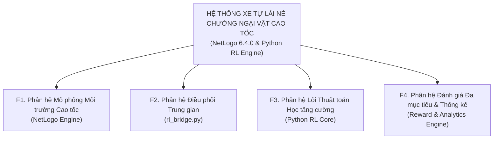

#### B. Sơ đồ FDD Mức 2 (Chi tiết từng Phân hệ):

**1. Chi tiết Phân hệ F1 - Mô phỏng Môi trường Cao tốc (NetLogo Engine):**
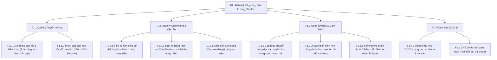

**2. Chi tiết Phân hệ F2 & F4 - Điều phối Trung gian & Đánh giá Đa mục tiêu:**
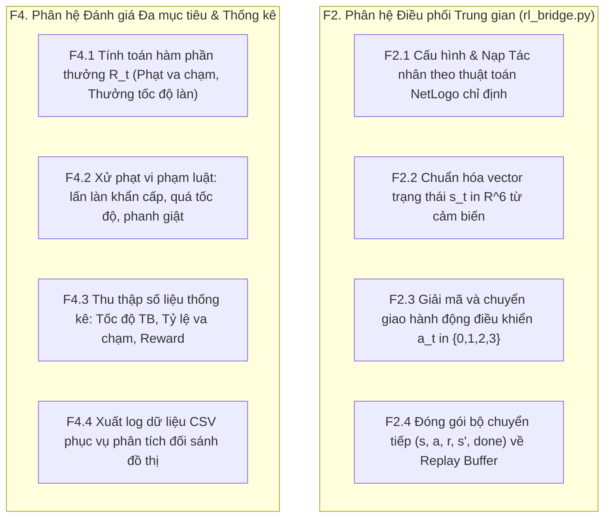

**3. Chi tiết Phân hệ F3 - Lõi Thuật toán Học tăng cường (Python RL Core):**
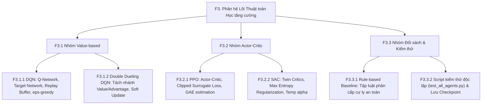

#### C. Bảng Danh mục Phân rã Chức năng Chi tiết:

| Mã CN | Tên Chức năng | Phân hệ Phụ trách | Mô tả Nghiệp vụ Chi tiết |
| :---: | :--- | :---: | :--- |
| **F1.1** | Quản lý Không gian Tuyến đường | NetLogo Engine | Khởi tạo cao tốc 1 chiều 4 làn (Làn 0: 120km/h, Làn 1: 100km/h, Làn 2: 80km/h, Làn 3: Dừng khẩn cấp cấm chạy). |
| **F1.2** | Quản lý Giao thông & Vật cản | NetLogo Engine | Sinh xe nền Nguồn-Đích ($x_{\min} \to x_{\max}$), sinh xe hỏng tĩnh ($v=0$) có cọc cảnh báo nguy hiểm, không có xe cứu hộ. |
| **F1.3** | Động lực học & Cảm biến | NetLogo Engine | Cập nhật gia tốc, chuyển làn mượt mà, cảm biến hình nón thích ứng tốc độ ($d_{\text{sensor}} = d_0 + v_t \cdot \tau$), phát hiện va chạm. |
| **F1.4** | Hiển thị Giao diện & Đồ thị | NetLogo Engine | Hiển thị 2D/3D trực quan, vẽ biểu đồ thời gian thực (Average Speed, Collisions) trên NetLogo GUI. |
| **F2.1** | Điều phối & Cấu hình Mô hình | `rl_bridge.py` | Nhận diện thuật toán chọn từ giao diện (DQN/DDQN/PPO/SAC/Baseline), khởi tạo class tác nhân tương ứng. |
| **F2.2** | Chuẩn hóa Giao tiếp I/O | `rl_bridge.py` | Chuyển đổi dữ liệu NetLogo thành vector $\mathbf{s}_t \in \mathbb{R}^6$, giải mã hành động $a_t \in \{0, 1, 2, 3\}$, gửi phản hồi cho xe AI. |
| **F3.1** | Thuật toán Value-based | Python RL | Cài đặt DQN và Double Dueling DQN với Replay Buffer, mạng Target, giảm thiểu Overestimation Bias. |
| **F3.2** | Thuật toán Actor-Critic | Python RL | Cài đặt PPO (Clipped Surrogate Loss, GAE) và SAC (Maximum Entropy, Twin Critics). |
| **F3.3** | Chuẩn Đối sánh & Test Suite | Python RL | Cài đặt Rule-based Baseline, script kiểm thử tự động `test_all_agents.py` và lưu trữ trọng số Checkpoints. |
| **F4.1** | Tính toán Hàm phần thưởng | MDP Engine | Áp dụng $\mathcal{R}_t$: Phạt va chạm ($-100$), thưởng tốc độ làn ($+3 \cdot v/v_{\text{limit}}$), phạt lấn làn khẩn cấp ($-5$), thưởng về đích ($+50$). |
| **F4.2** | Thống kê & Xuất Báo cáo | Analytics Engine | Ghi nhận log quá trình huấn luyện, trích xuất file CSV để vẽ biểu đồ so sánh hội tụ trong báo cáo tổng kết. |

---

### 3.2. Biểu đồ Ca Sử dụng (Use Case Diagram - UCD)

#### A. Sơ đồ UCD Tổng quan Mức 1:

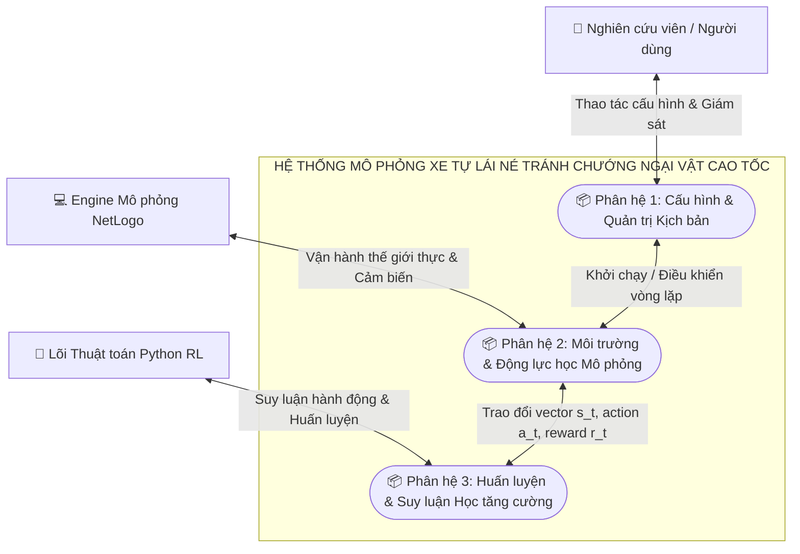

#### B. Sơ đồ UCD Chi tiết từng Phân hệ:

**1. Phân hệ 1: Ca sử dụng Dành cho Nghiên cứu viên / Người dùng:**
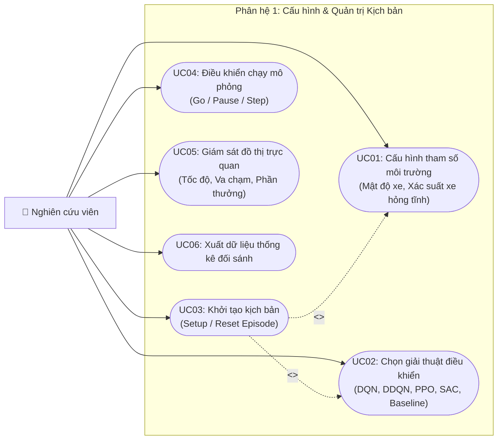

**2. Phân hệ 2: Ca sử dụng của Engine Mô phỏng NetLogo:**
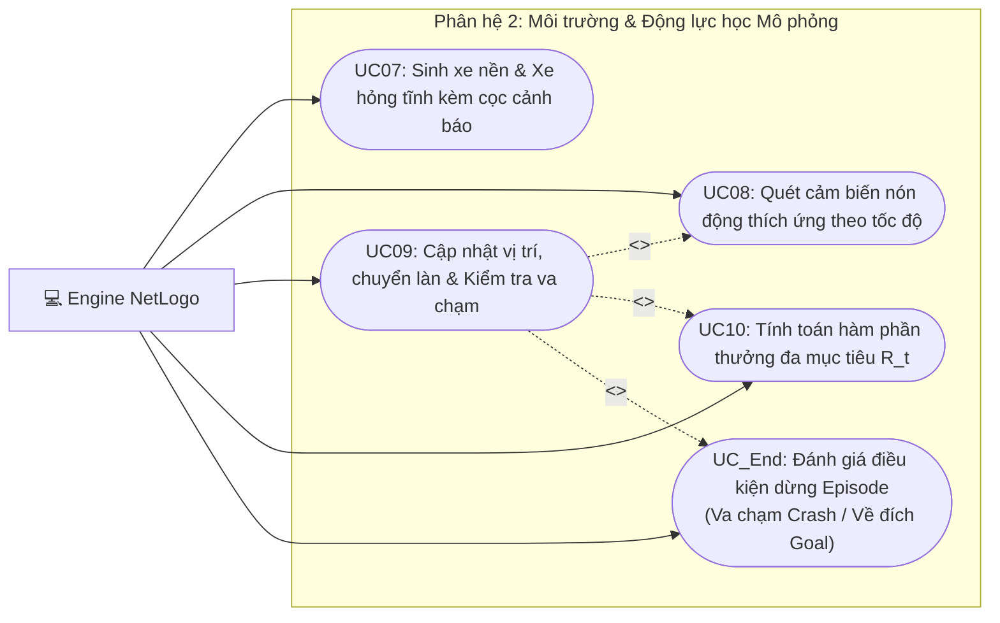

**3. Phân hệ 3: Ca sử dụng của Lõi Học máy Python RL:**
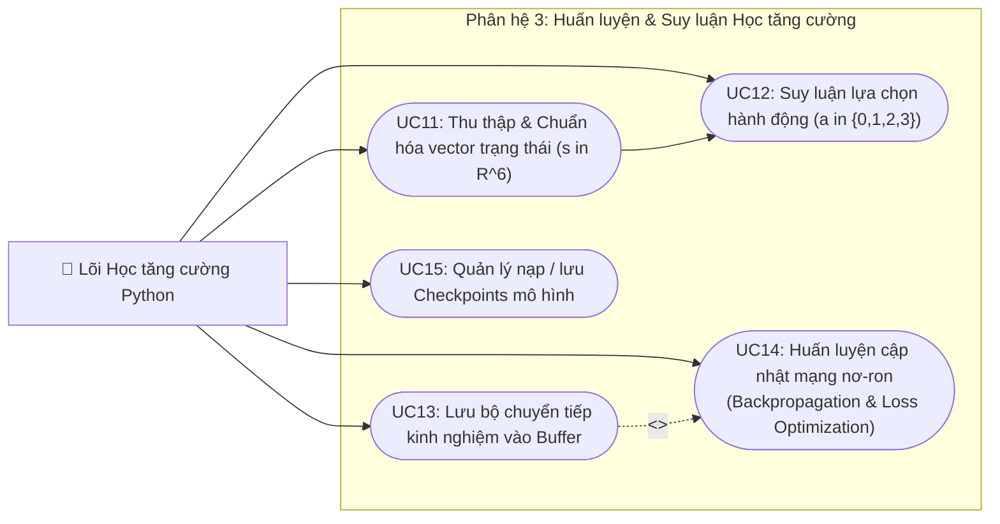

#### C. Sơ đồ UCD Toàn hệ thống Dạng Chiều dọc (Vừa khít 1 trang A4 dọc):

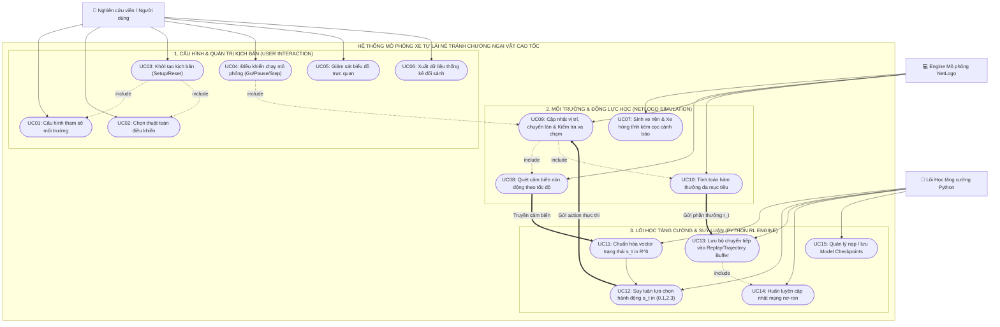

#### D. Bảng Đặc tả Ca Sử dụng Chi tiết:

| Mã UC | Tên Ca Sử dụng | Tác nhân chính | Tiền điều kiện | Luồng sự kiện chính | Hậu điều kiện |
| :---: | :--- | :---: | :--- | :--- | :--- |
| **UC01** | Cấu hình tham số | Nghiên cứu viên | Môi trường NetLogo đã nạp file `Expressways.nlogo` | Người dùng chỉnh slider số làn, mật độ xe, xác suất sinh xe hỏng tĩnh. | Tham số hệ thống được lưu vào biến toàn cục. |
| **UC02** | Chọn thuật toán RL | Nghiên cứu viên | Python bridge `py:setup` kết nối thành công | Chọn thuật toán trên Chooser (DQN, Double Dueling DQN, PPO, SAC, Baseline). | NetLogo phát tín hiệu nạp model tương ứng qua `rl_bridge.py`. |
| **UC03** | Khởi tạo kịch bản | Nghiên cứu viên | Đã chọn xong tham số | Nhấn nút `Setup`: Dựng đường 1 chiều 4 làn, sinh xe nền, đặt cọc cảnh báo xe hỏng tĩnh. | Môi trường sẵn sàng ở bước thời gian $t = 0$. |
| **UC04** | Điều khiển mô phỏng | Nghiên cứu viên | Hệ thống đã Setup xong | Nhấn `Go` để chạy liên tục, `Step` để chạy từng tick, hoặc tạm dừng quan sát. | Mô phỏng lặp chu kỳ tính toán theo từng bước $\Delta t$. |
| **UC05** | Giám sát đồ thị | Nghiên cứu viên | Mô phỏng đang chạy | Theo dõi đồ thị trực quan: Vận tốc trung bình, số vụ va chạm, tổng reward tích lũy. | Đồ thị cập nhật liên tục qua từng episode. |
| **UC06** | Xuất dữ liệu thống kê | Nghiên cứu viên | Hoàn thành số tick mục tiêu | Trích xuất dữ liệu mảng ra định dạng CSV để đối sánh hiệu năng các thuật toán. | File CSV lưu về thư mục `results/`. |
| **UC07** | Sinh xe & vật cản tĩnh | NetLogo Engine | Trong vòng lặp mô phỏng | Sinh xe nền tại $x_{\min}$; sinh xe hỏng tĩnh ($v=0$) kèm cọc tiêu cảnh báo nguy hiểm phía sau. | Chướng ngại vật tĩnh xuất hiện trên làn đường. |
| **UC08** | Quét cảm biến nón | NetLogo Engine | Xe AI đang di chuyển | Tính toán tầm quét radar thích ứng $d_{\text{sensor}}(v_t) = d_0 + v_t \cdot \tau_{\text{preview}}$, trích xuất khoảng cách/vận tốc vật cản. | Vector quan sát cảm biến được trích xuất. |
| **UC09** | Cập nhật vị trí & va chạm | NetLogo Engine | Nhận action từ AI | Cập nhật tọa độ $X, Y$, kiểm tra cự ly an toàn $d < d_{\text{collision}}$. Nếu va chạm hoặc về đích, kết thúc Episode. | Vị trí xe cập nhật mới; cờ `Done` bật nếu chạm điều kiện dừng. |
| **UC10** | Tính toán phần thưởng | NetLogo Engine | Hoàn thành 1 bước đi | Tính $\mathcal{R}_t$ dựa trên tốc độ đạt được, phạt va chạm ($-100$), phạt làn khẩn cấp ($-5$), thưởng về đích ($+50$). | Điểm $r_t$ được gửi sang Python bridge. |
| **UC11** | Chuẩn hóa trạng thái | Python RL | Nhận dữ liệu từ NetLogo | Chuyển đổi dữ liệu cảm biến thô thành tensor $\mathbf{s}_t = [\tilde{v}, \tilde{d}_{\text{ahead}}, \tilde{v}_{\text{ahead}}, \text{type}, \tilde{d}_{\text{behind}}, \tilde{v}_{\text{limit}}] \in \mathbb{R}^6$. | Vector $\mathbf{s}_t$ chuẩn hóa xong sẵn sàng cho mạng nơ-ron. |
| **UC12** | Suy luận hành động | Python RL | Đã có vector $\mathbf{s}_t$ | Mạng nơ-ron (DQN/DDQN/PPO/SAC) tính toán phân phối xác suất và xuất hành động $a_t \in \{0, 1, 2, 3\}$. | Hành động $a_t$ gửi về NetLogo thực thi. |
| **UC13** | Lưu bộ nhớ đệm | Python RL | Nhận $(s, a, r, s', \text{done})$ | Lưu chuyển tiếp vào Replay Buffer (DQN/DDQN/SAC) hoặc Trajectory Buffer (PPO). | Buffer tích lũy thêm dữ liệu huấn luyện. |
| **UC14** | Huấn luyện mạng | Python RL | Buffer đạt ngưỡng batch size | Lấy mẫu mini-batch, tính hàm mất mát (MSE/Clipped Loss), thực hiện lan truyền ngược Adam Optimizer. | Trọng số mạng nơ-ron được cập nhật tối ưu. |
| **UC15** | Quản lý Checkpoints | Python RL | Định kỳ hoặc hết bài tập | Lưu trọng số mạng đã huấn luyện (`.h5` / `.keras`) hoặc nạp mô hình sẵn có để chạy kiểm thử. | Trọng số mô hình được lưu trữ trên ổ cứng. |

---

## 4. Thiết kế kiến trúc môi trường thử nghiệm

Hệ thống được thiết kế theo mô hình **Kiến trúc Phân tầng Độc lập (Decoupled 3-Tier Layered Architecture)** kết hợp giữa **Tầng Mô phỏng Trực quan Đa tác nhân (NetLogo Engine)** và **Tầng Lõi Tính toán Học tăng cường Sâu (Python RL Core)** thông qua **Tầng Cầu nối Trung gian (`rl_bridge.py`)**.

### 4.1. Sơ đồ Kiến trúc Phân tầng Hệ thống

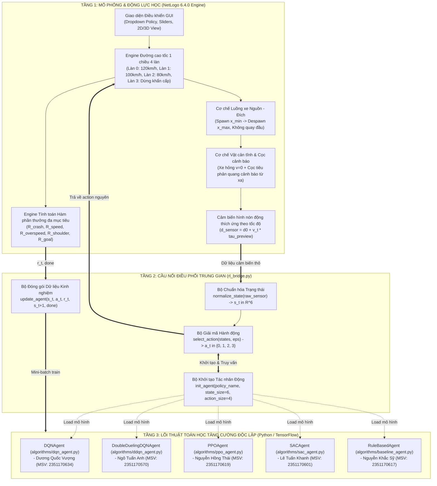

### 4.2. Sơ đồ Tuần tự Tương tác Thời gian thực (Runtime Sequence Diagram)

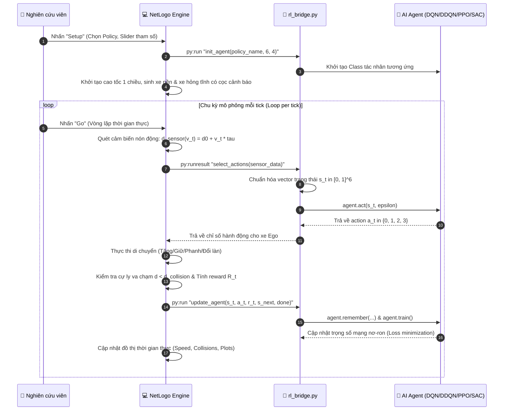

### 4.3. Đặc tả Chi tiết các Tầng Kiến trúc

1.  **Tầng Mô phỏng (NetLogo 6.4.0 Engine):**
    *   Tái hiện tuyến đường cao tốc 1 chiều 4 làn ($y \in \{3, 1, -1, -3\}$) với vạch sơn chuẩn, giảm $50\%$ tính toán thừa trên CPU.
    *   Cơ chế sinh dòng xe Nguồn - Đích tự tiêu hủy ở cuối đường ($x \ge x_{\max}$), loại bỏ hoàn toàn cơ chế quay đầu xe ngược chiều.
    *   Sinh xe hỏng tĩnh ($v = 0$) có cọc tiêu/biển tam giác cảnh báo nguy hiểm phía sau ở cự ly an toàn, không có xe cứu hộ.
    *   Hệ thống cảm biến hình nón động thích ứng theo vận tốc $d_{\text{sensor}}(v_t) = d_0 + v_t \cdot \tau_{\text{preview}}$.
2.  **Tầng Cầu nối Điều phối Trung gian (`rl_bridge.py`):**
    *   Truyền thông tin trực tiếp trong bộ nhớ qua NetLogo Python Extension (`py:run`, `py:runresult`) đạt tốc độ hàng nghìn bước/giây.
    *   Chuẩn hóa dữ liệu cảm biến thành vector $\mathbf{s}_t \in [0, 1]^6$ và giải mã chỉ số hành động $a_t \in \{0, 1, 2, 3\}$.
    *   Quản lý khởi tạo linh hoạt các mô hình tác nhân thông qua Factory Pattern.
3.  **Tầng Lõi Thuật toán Học tăng cường (`algorithms/`):**
    *   Đóng gói độc lập 4 thuật toán RL: DQN, Double Dueling DQN, PPO, SAC cùng Rule-based Baseline.
    *   Hỗ trợ kiểm thử độc lập qua `test_all_agents.py` và tối ưu hóa huấn luyện trên nền tảng TensorFlow/GPU.
4.  **Ưu điểm Kỹ thuật:**
    *   **Tránh xung đột Git:** Các thành viên làm việc độc lập trên từng file Python riêng biệt.
    *   **Tách biệt mối quan tâm (Separation of Concerns):** NetLogo chuyên trách đồ họa vật lý CPU, Python chuyên trách tính toán tensor và lan truyền ngược đạo hàm.
    *   **Khả năng mở rộng:** Dễ dàng bổ sung thuật toán mới mà không cần chỉnh sửa mã nguồn NetLogo.

---

## 5. Các thiết kế khác (nếu có)

Nhóm đã nghiên cứu và bổ sung các thiết kế kỹ thuật chuyên sâu nhằm tối ưu hóa tính hiện thực và độ ổn định của môi trường:

### 5.1. Thiết kế Hệ thống Cảm biến Hình nón Thích ứng Vận tốc (Dynamic Look-ahead Cone Sensor)
*   **Vấn đề:** Trong mô hình gốc, tầm quét radar chỉ cố định ở mức $2.5\text{ patches}$ ($\sim 8.75\text{ m}$). Khi xe chạy ở Làn 0 với tốc độ $33\text{ m/s}$ ($120\text{ km/h}$), thời gian từ lúc phát hiện chướng ngại vật đến khi đâm chỉ là $0.26\text{ s}$ $\to$ Quán tính vật lý không cho phép phanh kịp, dẫn tới tai nạn bất khả kháng.
*   **Giải pháp:** Tầm quét radar mở rộng tuyến tính theo vận tốc:
    $$d_{\text{sensor}}(v_t) = d_0 + v_t \cdot \tau_{\text{preview}}$$
    Với $d_0 = 3.0\text{ patches}$, $\tau_{\text{preview}} = 1.5\text{ s}$. Ở tốc độ $120\text{ km/h}$, tầm quét tự động đạt $\sim 30\text{ m}$ ($8 - 10\text{ patches}$), đảm bảo xe AI luôn có đủ thời gian phản xạ chuyển làn an toàn.

### 5.2. Thiết kế Cơ chế Sinh Dòng xe Nguồn - Đích (Source-Sink Traffic Spawner)
*   Xe nền được sinh ra ngẫu nhiên tại vạch xuất phát bên trái ($x = x_{\min}$) với xác suất $P_{\text{spawn}}$ khi khoảng trống làn đảm bảo an toàn và tổng số xe trên đường chưa vượt giới hạn trần $N_{\max}$.
*   Khi xe chạm mép cuối đường cao tốc ($x \ge x_{\max}$), xe tự động được tiêu hủy khỏi mô phỏng.
*   Thiết kế này chấm dứt hoàn toàn tình trạng xe quay đầu chạy ngược chiều gây xung đột vật lý với dòng phương tiện đang lưu thông.

### 5.3. Thiết kế Vùng Cảnh báo Nguy hiểm cho Xe hỏng Tĩnh (Hazard Warning Zone)
*   Mô phỏng chân thực Quy chuẩn giao thông đường bộ: Phương tiện gặp sự cố chết máy ($v = 0$) bật đèn khẩn cấp và đặt chóp nón phản quang / cọc tiêu cảnh báo phía sau xe ở cự ly an toàn ($15 - 30\text{ m}$).
*   Vùng cảnh báo này giúp cảm biến xe AI phát hiện vật cản từ rất sớm, tạo tiền đề để thuật toán học được hành vi chuyển làn mượt mà, không bị giật cục.

### 5.4. Các cải tiến và sửa lỗi trên mã nguồn gốc `marl4av`
1.  **Sửa lỗi cú pháp trong SAC:** Trong mã gốc tại dòng 759 có lỗi `self.value_net(states)` (lỗi dính từ khóa `self` của class hướng đối tượng). Nhóm đã tách hoàn chỉnh thành class `SACAgent` chuẩn trong [`algorithms/sac_agent.py`](file:///d:/Hoc_Tang_Cuong/marl4av/algorithms/sac_agent.py).
2.  **Hoàn thiện thuật toán PPO-Clip:** Mã gốc của `go-ppo` chỉ là hàm mất mát Policy Gradient cơ bản (Actor loss = $- \log \pi \times \delta$). Nhóm đã nâng cấp cài đặt đầy đủ công thức **Clipped Surrogate Loss** kèm **Generalized Advantage Estimation (GAE)** trong [`algorithms/ppo_agent.py`](file:///d:/Hoc_Tang_Cuong/marl4av/algorithms/ppo_agent.py).
3.  **Nâng cấp kiến trúc Dueling Network:** Bổ sung kiến trúc Dueling tách 2 nhánh Value $V(s)$ và Advantage $A(s, a)$ trong [`algorithms/ddqn_agent.py`](file:///d:/Hoc_Tang_Cuong/marl4av/algorithms/ddqn_agent.py).
4.  **Tối ưu hóa Hàm phần thưởng:** Thay thế cách cho điểm rời rạc bằng hàm thưởng đa mục tiêu liên tục theo vận tốc, khoảng cách an toàn và độ ổn định làn đường.

---

# II. Bảng tiến độ công việc

Cập nhật tiến độ dự án, khối lượng công việc và mức độ đóng góp của từng thành viên trong tuần vừa qua:

| STT | Thành viên | Mã SV | Nhiệm vụ phân công | Khối lượng công việc đã hoàn thành | Tỷ lệ hoàn thành | Đánh giá & Kế hoạch tuần tới |
| :---: | :--- | :---: | :--- | :--- | :---: | :--- |
| **1** | **Nguyễn Đình Tuấn Sơn** *(Trưởng nhóm)* | 2351170616 | **Cấu hình Môi trường & Tích hợp NetLogo** | - Clone mã nguồn `marl4av`, cài đặt NetLogo 6.4.0 và cấu hình Python bridge `py:setup`.<br>- Thiết lập cấu trúc đường cao tốc 1 chiều 4 làn, xóa cơ chế quay đầu.<br>- Xây dựng file cầu nối trung gian [`rl_bridge.py`](file:///d:/Hoc_Tang_Cuong/marl4av/algorithms/rl_bridge.py). | **85%** | **Xuất sắc**; Hoàn thiện việc gọi các hàm `py:run` từ giao diện NetLogo. |
| **2** | **Lê Tuấn Khanh** | 2351170601 | **Quản lý Vật cản, Cảm biến, Hàm thưởng & SAC** | - Cấu hình kịch bản sinh xe hỏng tĩnh ($v=0$) có cọc cảnh báo nguy hiểm.<br>- Tinh chỉnh hàm thưởng đa mục tiêu $\mathcal{R}$ ($R_{\text{crash}}, R_{\text{speed}}, R_{\text{rule}}$).<br>- Đồng cài đặt mạng SAC rời rạc và Rule-based Baseline. | **80%** | **Tốt**; Cân chỉnh xác suất sinh xe hỏng và khoảng cách đặt biển cảnh báo. |
| **3** | **Dương Quốc Vượng** | 2351170634 | **Cài đặt Thuật toán 1 (DQN)** | - Xây dựng hoàn chỉnh class `DQNAgent` trong [`algorithms/dqn_agent.py`](file:///d:/Hoc_Tang_Cuong/marl4av/algorithms/dqn_agent.py).<br>- Cài đặt mạng Q-Network, Target Network, Replay Buffer và $\epsilon$-greedy.<br>- Chạy kiểm thử độc lập qua `test_all_agents.py` đạt kết quả hội tụ tốt. | **80%** | **Tốt**; Tinh chỉnh siêu tham số chu kỳ cập nhật `update_steps` và kích thước batch. |
| **4** | **Ngô Tuấn Anh** | 2351170570 | **Cài đặt Thuật toán 2 (Double Dueling DQN)** | - Xây dựng class `DoubleDuelingDQNAgent` trong [`algorithms/ddqn_agent.py`](file:///d:/Hoc_Tang_Cuong/marl4av/algorithms/ddqn_agent.py).<br>- Sử dụng Functional API tách 2 nhánh Value $V(s)$ và Advantage $A(s, a)$.<br>- Cài đặt cơ chế cập nhật mềm Soft Update Target Network với $\tau = 0.005$. | **75%** | **Khá tốt**; Chạy thực nghiệm so sánh giảm thiểu Overestimation so với DQN. |
| **5** | **Nguyễn Hồng Thái** | 2351170619 | **Cài đặt Thuật toán 3 (PPO)** | - Xây dựng class `PPOAgent` trong [`algorithms/ppo_agent.py`](file:///d:/Hoc_Tang_Cuong/marl4av/algorithms/ppo_agent.py).<br>- Cài đặt chuẩn công thức Clipped Surrogate Loss ($r_t \hat{A}_t$ kẹp trong $[1-\epsilon, 1+\epsilon]$).<br>- Tích hợp thuật toán tính lợi thế GAE và lấy mẫu Categorical. | **75%** | **Khá tốt**; Huấn luyện PPO ổn định trên dữ liệu đa tác nhân mô phỏng. |
| **6** | **Nguyễn Khắc Sỹ** | 2351170617 | **Thuật toán 4 (SAC/Baseline), Đánh giá Đối sánh & Báo cáo** | - Tách và hoàn thiện `SACAgent`, sửa triệt để lỗi cú pháp `self` từ mã gốc NetLogo.<br>- Xây dựng class `RuleBasedAgent` trong [`algorithms/baseline_agent.py`](file:///d:/Hoc_Tang_Cuong/marl4av/algorithms/baseline_agent.py).<br>- Viết script kiểm thử chung `test_all_agents.py`, tổng hợp báo cáo TH2. | **80%** | **Tốt**; Thiết lập bảng thu thập số liệu đối sánh tốc độ và va chạm giữa các thuật toán. |

---

# III. Mã giả các thuật toán dự kiến sử dụng

Nhóm triển khai **4 thuật toán học tăng cường sâu** và **1 thuật toán chuẩn đối sánh (Baseline)**. Toàn bộ mã nguồn đã được đóng gói thành các class Python hoàn chỉnh trong thư mục [`algorithms/`](file:///d:/Hoc_Tang_Cuong/marl4av/algorithms/):

---

## 1. Thuật toán 1: Deep Q-Network (DQN) - Dương Quốc Vượng phụ trách

### 1.1. Lý do lựa chọn:
DQN (Mnih et al., 2015) là thuật toán Value-based nền tảng kinh điển cho không gian hành động rời rạc. DQN sử dụng mạng nơ-ron sâu xấp xỉ hàm giá trị tối ưu $Q^*(s, a)$, xóa bỏ tương quan chuỗi bằng **Experience Replay Buffer** và ổn định mục tiêu huấn luyện bằng **Target Network**:

$$y_i = r_i + \gamma \max_{a' \in \mathcal{A}} Q(s'_i, a'; \theta^-)$$

Hàm mất mát Mean Squared Error (MSE):
$$\mathcal{L}(\theta) = \frac{1}{B} \sum_{i=1}^B \Big( y_i - Q(s_i, a_i; \theta) \Big)^2$$

### 1.2. Mã giả thuật toán (đóng gói trong `algorithms/dqn_agent.py`):

```python
Class DQNAgent:
    Hàm khởi tạo __init__(state_size=6, action_size=4, hidden_size=64, lr=0.0005, memory_size=50000, update_steps=1000):
        Khởi tạo Replay Buffer D = [] với sức chứa tối đa memory_size
        Xây dựng mạng chính Q-Network: Dense(64, ReLU) -> Dense(64, ReLU) -> Dense(64, ReLU) -> Dense(4, Linear)
        Khởi tạo mạng Target Q-Network clone từ mạng chính (weights: θ^- = θ)
        Biên dịch mạng với Optimizer = Adam(lr), Loss = MSE
        Thiết lập chu kỳ đồng bộ Target: update_steps = 1000, step_count = 0

    Hàm chọn hành động act(states, epsilon=0.05):
        Nếu random() < epsilon:
            Trả về hành động ngẫu nhiên a ~ Uniform({0, 1, 2, 3})   # Khám phá (Exploration)
        Ngược lại:
            q_values = Q-Network.predict(states)
            Trả về argmax(q_values)                                  # Khai thác (Exploitation)

    Hàm lưu kinh nghiệm remember(experiences):
        Với mỗi bộ chuyển tiếp (s, a, r, s'):
            Lưu (s, a, r, s') vào Replay Buffer D
        Nếu len(D) > memory_size:
            Loại bỏ các mẫu cũ nhất (FIFO)

    Hàm huấn luyện train(batch_size=64, gamma=0.98):
        Nếu len(D) < batch_size: Thoát (chưa đủ dữ liệu khởi tạo)
        Lấy ngẫu nhiên batch_size mẫu (s, a, r, s') từ D
        targets = Q-Network.predict(s)
        next_q_target = Target_Network.predict(s')
        
        # Cập nhật mục tiêu Bellman
        Với mỗi mẫu i từ 0 đến batch_size - 1:
            targets[i, a[i]] = r[i] + gamma * max(next_q_target[i])
            
        loss = Q-Network.train_on_batch(s, targets)
        
        # Đồng bộ định kỳ sang Target Network
        step_count += 1
        Nếu step_count % update_steps == 0:
            Target_Network.set_weights(Q-Network.get_weights())
        Trả về loss
```

---

## 2. Thuật toán 2: Double Dueling DQN - Ngô Tuấn Anh phụ trách

### 2.1. Lý do lựa chọn:
1.  **Khắc phục hiện tượng Overestimation Bias:** DQN truyền thống thường đánh giá quá cao giá trị Q do toán tử $\max$. Thuật toán **Double Q-Learning** tách bạch tác vụ: dùng mạng chính để chọn hành động tốt nhất và dùng mạng đích để định giá trị cho hành động đó:
    $$y_i = r_i + \gamma Q\Big(s'_i, \arg\max_{a'} Q(s'_i, a'; \theta); \theta^-\Big)$$
2.  **Kiến trúc Dueling Network:** Tách 2 nhánh: Giá trị trạng thái tổng quát $V(s)$ và Lợi thế của từng hành động $A(s, a)$. Điều này đặc biệt hiệu quả trên cao tốc khi đường thông thoáng (hành động nào cũng mang lại giá trị cao như nhau):
    $$Q(s, a) = V(s) + \left( A(s, a) - \frac{1}{|\mathcal{A}|}\sum_{a'} A(s, a') \right)$$
3.  **Cập nhật mềm (Soft Update):** $\theta^- \leftarrow \tau \theta + (1-\tau)\theta^-$ với $\tau = 0.005$ giúp quá trình học ổn định vượt bậc.

### 2.2. Mã giả thuật toán (đóng gói trong `algorithms/ddqn_agent.py`):

```python
Class DoubleDuelingDQNAgent:
    Hàm khởi tạo __init__(state_size=6, action_size=4, lr=0.0003, tau=0.005, memory_size=50000):
        Khởi tạo Replay Buffer D = []
        Xây dựng mạng Dueling Architecture (Keras Functional API):
            inputs = Input(shape=(state_size,))
            x = Dense(64, ReLU)(inputs) -> Dense(64, ReLU)(x)
            val = Dense(32, ReLU)(x) -> Dense(1, Linear)(val)          # Nhánh Value V(s)
            adv = Dense(32, ReLU)(x) -> Dense(action_size, Linear)(adv) # Nhánh Advantage A(s, a)
            q_values = val + (adv - mean(adv, axis=1, keepdims=True))
        Khởi tạo Target Network clone từ Dueling Network chính

    Hàm huấn luyện train(batch_size=64, gamma=0.98):
        Nếu len(D) < batch_size: Thoát
        Lấy ngẫu nhiên batch_size mẫu (s, a, r, s') từ D
        targets = Q-Network.predict(s)
        
        # --- CỐT LÕI DOUBLE Q-LEARNING ---
        # 1. Dùng mạng CHÍNH để chọn hành động tốt nhất ở trạng thái tiếp theo:
        next_q_main = Q-Network.predict(s')
        best_actions = argmax(next_q_main, axis=1)
        
        # 2. Dùng mạng TARGET để định giá trị cho hành động tốt nhất đó:
        next_q_target = Target_Network.predict(s')
        double_q = next_q_target[arange(batch_size), best_actions]
        
        targets[arange(batch_size), a] = r + gamma * double_q
        loss = Q-Network.train_on_batch(s, targets)
        
        # Cập nhật mềm (Soft Update) Target Network
        weights_target = tau * weights_main + (1 - tau) * weights_target
        Target_Network.set_weights(weights_target)
        Trả về loss
```

---

## 3. Thuật toán 3: Proximal Policy Optimization (PPO) - Nguyễn Hồng Thái phụ trách

### 3.1. Lý do lựa chọn:
PPO (Schulman et al., 2017) là thuật toán Actor-Critic (On-policy) tiên tiến bậc nhất hiện nay. PPO giải quyết triệt để nguy cơ sụp đổ chính sách khi bước cập nhật quá lớn bằng hàm mục tiêu xén **Clipped Surrogate Objective**:

$$L^{\text{CLIP}}(\theta) = \hat{\mathbb{E}}_t \left[ \min\Big( r_t(\theta)\hat{A}_t,\; \text{clip}(r_t(\theta), 1-\epsilon, 1+\epsilon)\hat{A}_t \Big) \right]$$

với tỉ số xác suất $r_t(\theta) = \frac{\pi_\theta(a_t \mid s_t)}{\pi_{\theta_{\text{old}}}(a_t \mid s_t)}$. PPO tích hợp **Generalized Advantage Estimation (GAE)** giúp cân bằng giữa độ lệch (bias) và phương sai (variance), tạo ra quỹ đạo lái xe mượt mà, ổn định và tránh giật cục.

### 3.2. Mã giả thuật toán (đóng gói trong `algorithms/ppo_agent.py`):

```python
Class PPOAgent:
    Hàm khởi tạo __init__(state_size=6, action_size=4, clip_ratio=0.2, gamma=0.98, gae_lambda=0.95):
        Mạng Actor: Dense(64, ReLU) -> Dense(64, ReLU) -> Dense(4, Softmax) -> π(a|s)
        Mạng Critic: Dense(64, ReLU) -> Dense(64, ReLU) -> Dense(1, Linear) -> V(s)
        Bộ đệm quỹ đạo Trajectory Buffer lưu (states, actions, rewards, next_states, old_log_probs, dones)

    Hàm chọn hành động act(states):
        probs = Actor.predict(states)
        Lấy mẫu hành động a ~ Categorical(probs)
        log_prob = log(probs[a])
        Lưu log_prob vào bộ nhớ tạm thời
        Trả về hành động a

    Hàm tính Lợi thế compute_gae(rewards, values, next_values, dones):
        delta = rewards + gamma * next_values * (1 - dones) - values
        gae = 0, advantages = []
        Duyệt ngược từ bước cuối cùng về bước đầu:
            gae = delta[t] + gamma * gae_lambda * (1 - dones[t]) * gae
            Chèn gae vào đầu mảng advantages
        returns = advantages + values
        Chuẩn hóa advantages: adv = (adv - mean(adv)) / (std(adv) + 1e-8)
        Trả về advantages, returns

    Hàm huấn luyện train(epochs=4, batch_size=64):
        advantages, returns = compute_gae(...)
        Lặp epoch từ 1 đến epochs:
            Chia dữ liệu thành các mini-batches:
                Với mỗi mini-batch:
                    # 1. Cập nhật Actor với Clipped Surrogate Loss
                    new_probs = Actor(batch_states)
                    ratios = exp(new_log_probs - old_log_probs)
                    surr1 = ratios * batch_advantages
                    surr2 = clip(ratios, 1 - clip_ratio, 1 + clip_ratio) * batch_advantages
                    actor_loss = - mean(min(surr1, surr2)) - entropy_coeff * Entropy(new_probs)
                    Adam_Optimize(Actor, actor_loss)
                    
                    # 2. Cập nhật Critic với MSE Loss
                    critic_loss = MSE(Critic(batch_states), batch_returns)
                    Adam_Optimize(Critic, critic_loss)
        Xóa sạch bộ đệm Trajectory Buffer sau khi cập nhật On-Policy
```

---

## 4. Thuật toán 4: Soft Actor-Critic (SAC) - Lê Tuấn Khanh & Nguyễn Khắc Sỹ phụ trách

### 4.1. Lý do lựa chọn:
- **Maximum Entropy Reinforcement Learning:** Thuật toán Off-policy Actor-Critic tối đa hóa đồng thời phần thưởng kỳ vọng và Entropy của chính sách $H(\pi)$:
  $$J(\pi) = \sum_{t=0}^T \mathbb{E}_{(s_t, a_t)} \Big[ r(s_t, a_t) + \alpha \mathcal{H}(\pi(\cdot \mid s_t)) \Big]$$
  Hệ số nhiệt độ $\alpha$ kích thích xe AI liên tục khám phá các lộ trình vượt xe an toàn mới, tránh bị sa lầy vào các điểm cực tiểu cục bộ (Local Optima).
- **Twin Critics Architecture:** Sử dụng hai mạng Critic độc lập $Q_1, Q_2$ và lấy giá trị $\min(Q_1, Q_2)$ để triệt tiêu hoàn toàn Overestimation Bias trong không gian hành động rời rạc. Đã được sửa triệt để lỗi cú pháp từ mã nguồn gốc NetLogo.

### 4.2. Mã giả thuật toán (đóng gói trong `algorithms/sac_agent.py`):

```python
Class SACAgent:
    Hàm khởi tạo __init__(state_size=6, action_size=4, lr=0.0003, alpha=0.2, tau=0.005, memory_size=50000):
        Mạng Actor: π(a|s) xuất phân phối Softmax
        Hai mạng Twin Critics độc lập: Q1(s, a), Q2(s, a)
        Hai mạng Target Twin Critics: Q1_target, Q2_target clone từ Q1, Q2
        Khởi tạo Replay Buffer D = []

    Hàm huấn luyện train(batch_size=64, gamma=0.98):
        Nếu len(D) < batch_size: Thoát
        Lấy mini-batch ngẫu nhiên (s, a, r, s', done) từ D
        
        # 1. Tính giá trị mục tiêu Target Value có Entropy Regularization
        next_action_probs = Actor(s')
        min_next_target_q = min(Q1_target(s'), Q2_target(s'))
        next_v = sum(next_action_probs * (min_next_target_q - alpha * log(next_action_probs + 1e-8)), axis=1)
        target_q = r + (1 - done) * gamma * next_v
        
        # 2. Cập nhật Twin Critics qua MSE Loss
        loss_q1 = MSE(Q1(s)[a], target_q)
        loss_q2 = MSE(Q2(s)[a], target_q)
        Adam_Optimize(Q1, loss_q1); Adam_Optimize(Q2, loss_q2)
        
        # 3. Cập nhật Actor tối đa hóa Q-value và Entropy
        action_probs = Actor(s)
        min_current_q = min(Q1(s), Q2(s))
        actor_loss = mean(sum(action_probs * (alpha * log(action_probs + 1e-8) - min_current_q), axis=1))
        Adam_Optimize(Actor, actor_loss)
        
        # 4. Cập nhật mềm Target Critics
        Q1_target = tau * Q1 + (1 - tau) * Q1_target
        Q2_target = tau * Q2 + (1 - tau) * Q2_target
```

---

## 5. Thuật toán Đối sánh Chuẩn: Rule-based Baseline Agent

### 5.1. Lý do lựa chọn:
Để chứng minh tính vượt trội của các thuật toán Học tăng cường, nhóm xây dựng một tác nhân chuẩn đối sánh dựa trên tập luật an toàn giao thông cổ điển (khoảng cách an toàn radar, quy tắc đổi làn khi có chướng ngại vật đứng yên).

### 5.2. Mã giả thuật toán (đóng gói trong `algorithms/baseline_agent.py`):

```python
Class RuleBasedAgent:
    Hàm chọn hành động act(states):
        d_ahead = states[1]          # Cự ly xe/vật cản phía trước
        v_ahead = states[2]          # Vận tốc vật cản phía trước
        type_ahead = states[3]       # 1.0 nếu là xe hỏng tĩnh / cọc cảnh báo
        
        Nếu type_ahead == 1.0 và d_ahead < 0.6:
            Trả về 3 (Đổi làn khẩn cấp để né xe hỏng tĩnh)
        Nếu d_ahead < 0.2:
            Trả về 2 (Phanh khẩn cấp để tránh va chạm)
        Nếu d_ahead < 0.4:
            Trả về 3 (Đổi làn vượt chướng ngại vật)
        Nếu d_ahead >= 0.7:
            Trả về 0 (Tăng tốc áp sát tốc độ tối đa của làn)
        Ngược lại:
            Trả về 1 (Duy trì tốc độ ổn định)
```

---

# KẾT LUẬN & KẾ HOẠCH TUẦN TIẾP THEO

1.  **Về Môi trường Thử nghiệm:** Nhóm đã hoàn thành tinh chỉnh toàn diện môi trường mô phỏng `Expressways.nlogo`:
    *   Tuyến đường cao tốc 1 chiều 4 làn chuẩn hóa phân cấp tốc độ ($120 - 100 - 80\text{ km/h}$).
    *   Cơ chế sinh xe hỏng tĩnh ($v = 0$) kèm cọc/biển cảnh báo nguy hiểm, xóa bỏ cơ chế dừng đột ngột và loại bỏ xe cứu hộ.
    *   Hệ thống cảm biến hình nón động thích ứng theo tốc độ, giải quyết dứt điểm nghịch lý cự ly phanh ở vận tốc cao.
2.  **Về Lõi Thuật toán & Cầu nối:** Cả 4 thuật toán RL (DQN, Double Dueling DQN, PPO, SAC) cùng Baseline đã được đóng gói thành các Class Python độc lập, kết nối mượt mà với NetLogo qua [`rl_bridge.py`](file:///d:/Hoc_Tang_Cuong/marl4av/algorithms/rl_bridge.py) và đã kiểm thử thành công qua script [`test_all_agents.py`](file:///d:/Hoc_Tang_Cuong/marl4av/algorithms/test_all_agents.py).
3.  **Kế hoạch tuần tiếp theo:**
    *   Tiến hành chạy mô phỏng huấn luyện từ $3.000 - 5.000\text{ ticks}$ trên NetLogo cho từng thuật toán.
    *   Trích xuất dữ liệu log sang file CSV: Tốc độ trung bình (Average Speed), Tỷ lệ va chạm (Collision Rate), Phần thưởng tích lũy (Cumulative Reward).
    *   Vẽ đồ thị học tập (Learning Curves) so sánh đối sánh hiệu năng toàn diện giữa 4 thuật toán RL và Baseline.
    *   Hoàn thiện slide thuyết trình báo cáo nghiệm thu đề tài.
